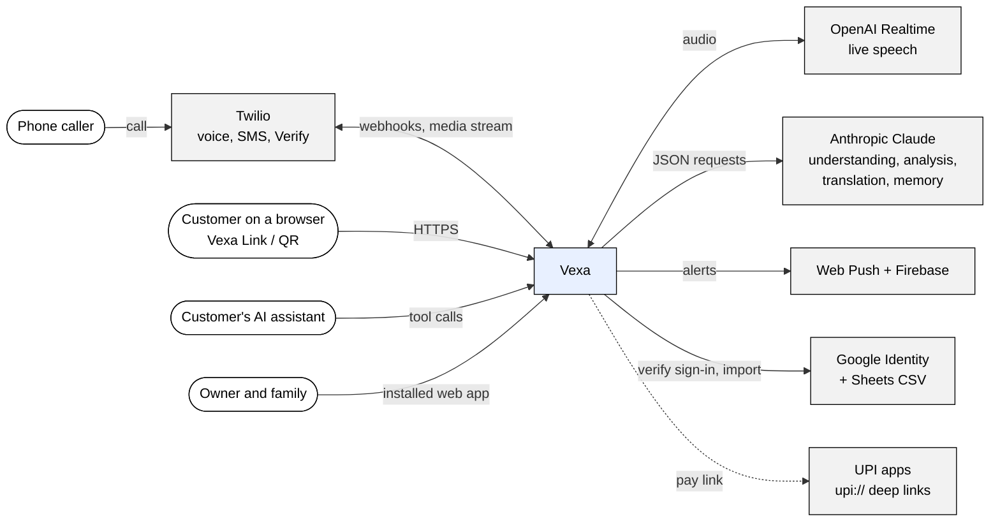
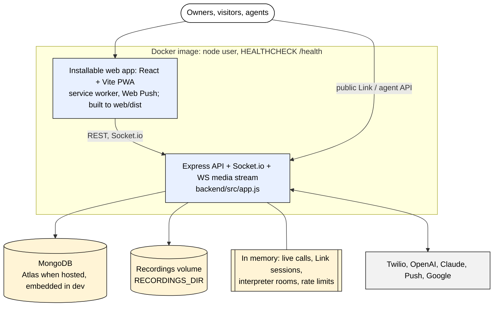
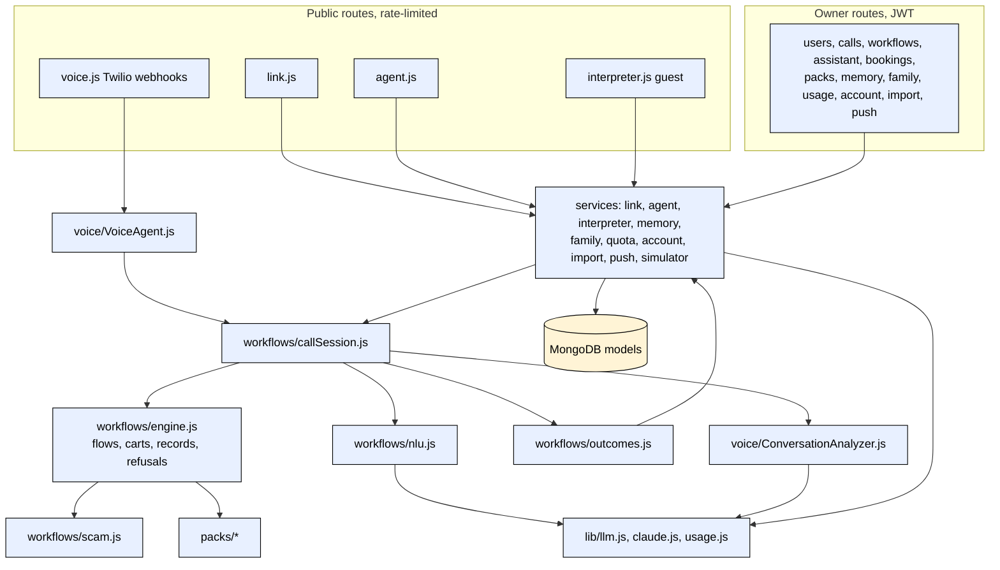
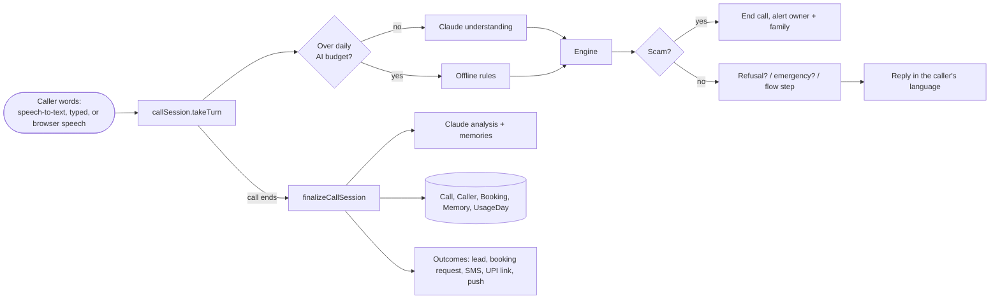
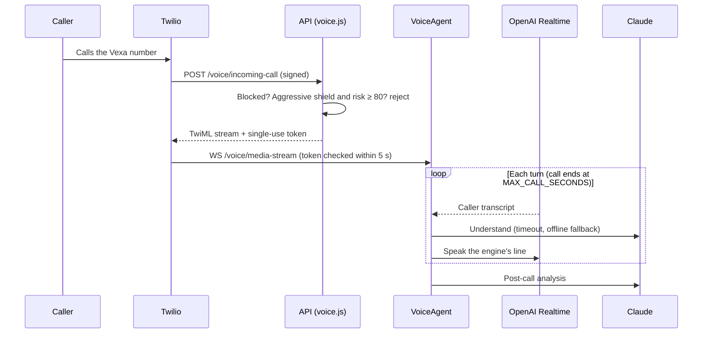
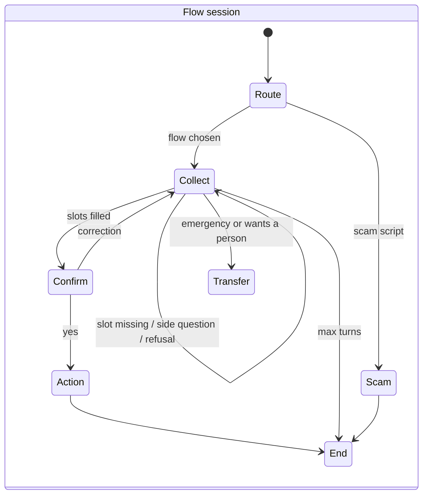
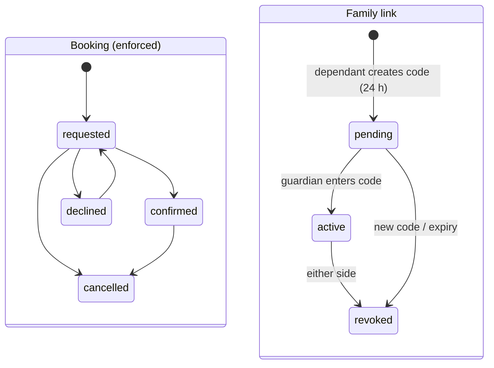
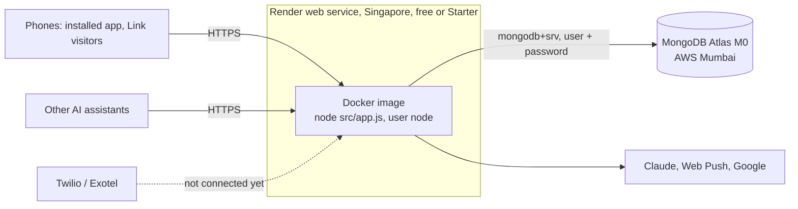
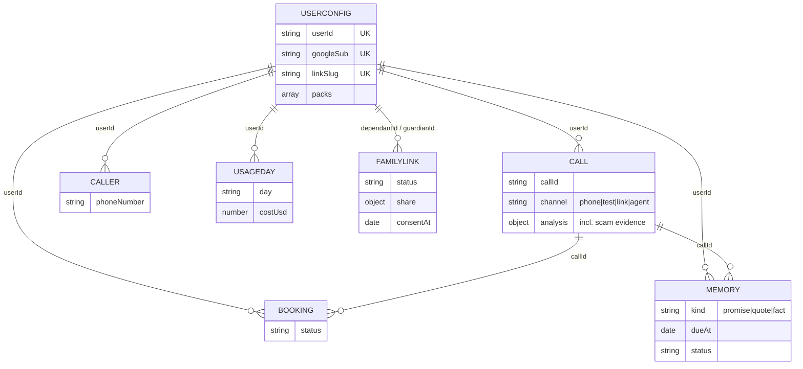

# 📞 Vexa — AI Receptionist for People and Small Businesses

Vexa answers your phone when you can't. It follows **multi-turn call flows** (quote, booking, emergency, delivery and others), understands callers in one sentence, answers their questions mid-call, and only interrupts you when it matters.

It works in two modes:
- **Personal**: screens unknown callers, handles deliveries, shuts down spam, and protects your focus time.
- **Business**: a receptionist that captures leads, takes booking requests, escalates emergencies and texts confirmations.

## Guardrails and evals

### Guardrails

| Guardrail | What it prevents | Where it is enforced | Default and flag |
|---|---|---|---|
| Login and tokens | Account takeover, code guessing | `otpService.js`, `middleware/auth.js` | Hashed codes, 10 min, 5 tries; JWT 7 d / 30 d; production requires `JWT_SECRET` |
| Rate limits | Abuse and runaway cost | `app.js`, `routes/auth.js`, `simulator.js`, `assistant.js` | API 600/15 min; codes 5/15 min; test calls 40/min; commands 30/min; outbound calls 10/min (in memory) |
| Owner isolation | One owner seeing another's calls | Every query scoped by `req.userId`; `ownedCall()` for live calls | On |
| Twilio signature | Forged call webhooks | `routes/voice.js` `twilioWebhook` | On in production; `TWILIO_VALIDATE_SIGNATURE` |
| Call audio stream token | A stranger opening a call's audio socket and driving the AI | `lib/streamToken.js`, `VoiceAgent.handleMediaStream` | On (single-use, 2-minute, bound to the call id); socket closed if no valid start within 5 s; `STREAM_AUTH=off` ignored in production |
| Spam screening | Robocalls and spoofing reaching the owner | `workflows/risk.js`, `routes/voice.js` | Risk 0–100; blocked numbers rejected; aggressive shield rejects ≥ 80 |
| Flow validation | Broken, looping or dead-end flows | `workflows/validate.js` | Known steps only, valid targets, end step required, `maxTurns` 2–20 |
| Engine limits | Endless calls | `workflows/engine.js` | 10 turns, 2 re-asks, 50-step loop guard; partial message saved |
| Emergency override | Missing a real emergency | `engine.js` emergency switch, `callSession.js` urgent alert | Escalation words + model flag; owner alerted mid-call |
| Who gets through | Interruptions the owner didn't want | `engine.js` `transfer_allowed` | VIP / always-transfer / emergency; never in Focus; business hours |
| Human approval | AI committing the owner | `outcomes.js`, `PATCH /api/bookings/:id` | Bookings are requests until the owner confirms |
| Grounded answers | Made-up prices, hours or directions | `nlu.js`, `callSession.js` directions prompt, `PromptGenerator.js` | "Answer ONLY from" business info; catalog for prices |
| Prompt-injection sanitizer | Owner or caller text taking over prompts | `PromptGenerator._sanitize` | Strips "ignore previous instructions", "system prompt" and similar |
| Model failure fallbacks | A slow or refusing model stalling a call | `nlu.js`, `translate.js`, `claude.js`, `ConversationAnalyzer.js` | Hard timeouts; offline rules; English; keyword analysis; refusal fallback (`ANTHROPIC_FALLBACKS`) |
| Transcript filters | Acting on noise or echoes | `VoiceAgent.js` transcript handler | Noise, echo, URL, gibberish, post-interruption fragments dropped; backchannels ignored |
| Recording consent and retention | Recording without notice; keeping audio forever | `callSession.js`, `media.js` | Notice on; 90 days; per-call delete; 15-minute signed links |
| Dev-only routes | Demo data in production | `users.js`, `media.js` | Off in production unless `ENABLE_DEMO_DATA=true` |
| Secrets | Keys leaking through the repo or logs | `backend/.env` (git-ignored), `.dockerignore`, `lib/redact.js` | Only `.env.example` is tracked; every log line scrubbed of API keys and bearer tokens |
| Test-call isolation | Rehearsals polluting real data | `simulatorService.js`, `callHistoryService.js`, `outcomes.js` | No caller memory, no real SMS |
| Scam shield | Fraud scripts (digital arrest, fake courier, KYC/SIM block, impostor relative, prize) and OTP/PIN/remote-app requests reaching the owner or getting answers | `workflows/scam.js`, `engine.js` step 0, `callSession.js` alert | On for every account; skipped for VIPs and always-transfer callers; delivery OTPs at the door allowed |
| Pack refusal rules | Medical advice, allergen promises, fixed quotes, mark guarantees, treatment-safety calls, religion/caste/diet property filters | `packs/*.js` `guardrails.refuse`, `engine.js` `refusalFor`, model `restricted` label | On when the pack is installed |
| Record privacy | Order, report or fee status told to the wrong person | `engine.js` `lookupRecord` | Shared only when the caller's phone (or name, if the record has no phone) matches |
| Payment link limit | The AI asking for large payments on its own | `outcomes.js` `pay_link` | Above `payLinkAutoLimit` (₹5,000 default) the link waits for owner approval; simulated on test calls |
| Vexa Link caps and anonymity | Runaway AI cost; strangers reading private records | `routes/link.js`, `linkService.js` | 10 starts/h and 30 msgs/min per IP; 40 msgs/chat; daily limit 50 (owner-set); no memory, recording or record read-outs |
| Agent requests need approval | Another AI committing the business | `agentService.js` | Bookings/orders are requests; no records; `ask` → published info or "unknown"; 60/min per IP; daily cap 100 |
| Family consent | Watching someone's calls without permission | `familyService.js` | Dependant creates the code and chooses what is shared; transcripts off by default; either side can end it |
| Memory hygiene | Storing secrets or scam content | `memoryService.saveFromCall` | Nothing from spam/scam calls; OTP/PIN/card-like text dropped; owner-only |
| Google sign-in verification | Forged sign-in tokens | `routes/auth.js` `/google` | Signature, audience, expiry and verified email checked; off unless `GOOGLE_CLIENT_ID` |
| Server-only fields | Leaking push endpoints or device tokens | `routes/users.js` `publicConfig` | Stripped from every config response |
| Daily AI budget and kill switch | Runaway model cost | `services/quotaService.js`, `lib/llm.js` | $5/day per account (owner-set, max `MAX_DAILY_AI_BUDGET_USD`); alerts at 80% and 100%; over budget → offline rules; `AI_KILL_SWITCH` |
| Call length ceiling | Endless or abusive live calls | `voice/VoiceAgent.js` | Wraps up and hangs up at `MAX_CALL_SECONDS` (900) |
| Import URL allow-list | Server-side request forgery | `services/importService.js` `sheetCsvUrl` | Only `https://docs.google.com/spreadsheets/…` CSV exports; 900 KB, 2,000 rows, 15 s |
| Booking transitions | Reopening cancelled bookings by mistake | `routes/assistant.js` | requested → confirmed/declined/cancelled; confirmed → cancelled; declined → requested; else 409 |
| Your data | Data kept after an owner leaves | `services/accountService.js` | Export everything; delete account erases calls, recordings, memories, family links |
| Supply chain and container | Vulnerable dependencies; root in the container | `.github/workflows/ci.yml`, `Dockerfile` | `npm audit --audit-level=high` fails CI (backend + web); image runs as `node` with a HEALTHCHECK |

### Evals and quality gates

| Eval | What it measures | When it runs | Threshold | Status |
|---|---|---|---|---|
| Indian-language understanding set (`backend/eval/nlu`) | Language, code-mixing, facts, yes/no, phone numbers across 8 languages (161 cases) | Every change in CI (offline, `--min 0.97`); `-- --mode claude` on demand | ≥ 97% offline (CI gate); ≥ 90% mixed-language target | Live · offline 99%, Claude 100% (157-case run) |
| Held-out set (`holdout.jsonl`) | Same, 50 new phrasings never tuned against | Every change in CI (`--min 0.95`) | Should track the main set | Live · offline 98%, Claude 100% |
| Pack + scam eval (`backend/eval/packs`) | 45 scripted calls across 7 packs (flow, outcome, actions, refusals, what must never be said) and 26 scam scripts plus lookalike genuine calls (precision, recall, leaks); accounts pass through the real database schema | Every change in CI (offline, `--min 1`); `-- --mode claude` on demand | 100% and zero leaks (CI gate) | Live · offline 71/71, scam precision 1.0, recall 1.0, 0 leaks |
| Backend unit tests | Flows, extractors, emergency, shields, Focus, sanitizer, recorder, Indian numbers/dates/yes-no, stream-token and log-redaction security, packs, orders, records, listings, refusals, scam shield, UPI links; memories, Ask Vexa parsing, link names, push subscriptions, interpreter fallback, agent tool schemas; daily budget, CSV import and Sheets allow-list | `npm test` before release | All pass | Live · 71 tests passing, run in CI |
| Mobile tests | App render, API client, transcript store | `jest` in `mobile/` | All pass | Partial · 9 tests |
| Web app checks | Type safety and build | `tsc -b && vite build`, `oxlint` | No errors | Partial · no unit tests |
| Runtime quality signals | Model used per turn, latency, tokens and cost by purpose, questions asked/skipped, risk, action status | Every call (saved on the call) | — | Live |
| Per-flow stats | Runs, completed, transferred, average turns and questions (30 days) | `GET /api/workflows` | — | Live |
| Speech eval on real Indian voices | Word error rate, language detection, facts from audio, reply latency | Planned (Phase 1B/1C) | ≥ 95% facts clean, ≥ 90% noisy, ≤ 1.5 s p95 | Planned |
| CI pipeline | Backend tests, understanding gate, web lint and build, Docker build, dependency audit | GitHub Actions on every push and pull request (`.github/workflows/ci.yml`) | All jobs green | Live |
| Live checks with Claude (manual, this release) | Vexa Link order → UPI button; memory quote and promise answered; Hindi⇄Telugu interpreter; family scam alert; agent-to-agent order; production Docker image with MongoDB | Before release | All pass | Partial · scripted, not in CI |
| Fast-model comparison (`eval/nlu/FAST_MODELS.md`) | Understanding accuracy, facts, latency and cost per model | On demand when changing models | Choose the model with 100% facts | Live · Sonnet 5.5 98% / 100% facts at 2.1 s; Haiku 5.5 96% |
| Dependency audit | High and critical advisories in production dependencies | Every change in CI (backend and web) | 0 high, 0 critical | Live · passes (8 moderate behind firebase-admin 14) |

---

## Vexa — end-to-end workflow

How an owner sets Vexa up, how every call is answered, understood and acted on, and what happens after it ends. Each box names the exact code path, model, API or data store involved; numbered badges match the step-by-step walkthrough below.


<sub>Source of truth: Phani3108/Vexa, branch ship-wave1 (commit cdf7d07, 29 Oct 2026) · Full readout with every table: [readout.html](readout.html) (open locally or download).</sub>

| | |
|---|---|
| **Scope** | UC1 Set up the assistant · UC2 Answer a call (live phone calls and in-app test calls) · UC3 After the call. Personal and Business modes share the same pipeline. · UC4 Beyond the phone line: Vexa Link, interpreter, agent API · Wave 1: packs, scam shield, memory, family guardian |
| **Source of truth** | github.com/Phani3108/Vexa · branch `ship-wave1` · commit `cdf7d07` · 29 Oct 2026 · backend/src, web/src, backend/.env.example, Dockerfile, docker-compose.yml, .github/workflows, backend/test, backend/eval |
| **Planned items** | From ROADMAP.md (India-first plan): Indian speech engines and voices, Indian phone number, WhatsApp, UPI, calendar and CRM. Drawn as Not integrated. |
| **Live status** | Text understanding, flows, analysis, translation and the app run end to end today. The live phone path (Twilio + OpenAI Realtime) is complete in code but has not been run on a real call: no Twilio or OpenAI keys are configured. |
| **Prepared by** | Phani Marupaka with Claude Code · 29 Oct 2026 |

### The flow, step by step

_Numbers match the badges in the diagram._

**UC1 · Sign in**

1. The owner opens the Vexa app (installable web app, or the mobile app) and enters a phone number. The app calls `POST /api/auth/otp/request`, then `POST /api/auth/otp/verify` with the 6-digit code.
2. The server stores only a hash of the code, accepts it for 10 minutes and allows 5 tries. A correct code returns a 7-day access token and a 30-day refresh token. The first login creates the account.
3. The code is sent by Twilio Verify, or as a plain Twilio SMS. In development no SMS is sent and the code is shown on screen.
4. Codes and accounts live in MongoDB. Expired codes delete themselves.
5. Rate limits stop code guessing and SMS abuse, and production will not start with a weak signing secret.
56. Where SMS codes aren't set up, owners sign in with Google; the server verifies Google's ID token for this app before issuing Vexa's own tokens.

**UC1 · Configure flows, business and languages**

6. The owner picks Personal or Business, an industry template, opening hours, a product catalog with stock and prices, FAQs, VIP contacts, the greeting language and recording settings.
7. Vexa ships 17 ready-made call flows. Owners can edit them step by step; every edit is checked before it is saved, so a flow can't loop or dead-end.
8. Owners can also just say what they want ("I'm busy until 7 pm", "block that number"). Claude turns that into actions; a rule-based parser takes over if Claude is unavailable.
9. Settings, the catalog, shields and notes for specific callers are stored in MongoDB.
10. Only approved fields can be edited, commands are rate-limited and capped, and the built-in safety flows can't be removed.
50. A business can install a ready-made pack for its trade. Its flows replace the generic ones and a sample business can be loaded to try it at once (`POST /api/packs/:id/install`).

**UC2 · Ring and screen**

11. A caller dials the owner. The owner's carrier forwards the call to the Vexa Twilio number. Owners can rehearse the same pipeline with an in-app test call.
12. Before answering, Vexa finds the owner, recalls the caller, checks VIPs, Focus and business hours, and scores spam risk. Blocked or very risky callers are rejected before any AI cost. Twilio is told to stream the audio to Vexa.
13. The OpenAI Realtime voice speaks the greeting written by the flow engine, including the recording notice.
14. Twilio sends call events to Vexa's webhooks and streams the audio in both directions over a WebSocket.
15. Caller history is read: their name, what past calls were about, any note the owner left for them, and whether they are usually spam.
16. Twilio signatures are verified in production, and the call's audio stream is only accepted with a single-use token signed for that exact call. The risk score and the owner's shield decide how strict to be.

**UC2 · Listen and understand**

17. The owner can watch the call live: the transcript, the facts Vexa has captured and the caller's language.
18. Each caller sentence is cleaned (noise, echoes and false starts are dropped) and processed in order, one turn at a time.
19. OpenAI turns the caller's speech into text. On flow calls the voice model never answers on its own; the flow engine decides every reply.
20. Claude reads each sentence and returns structured facts in English: which flow, names, dates, quantities, any question, an emergency, the language and an English translation. It has 5 seconds.
21. The live call's state is kept in server memory and is lost if the server restarts.
22. If Claude is slow or down, built-in rules understand Indian numbers, dates, yes/no and phone numbers in eight languages, so the call keeps going.
23. This understanding is measured on 211 test sentences in eight languages, including 50 held back from tuning.
51. Every sentence is first checked by the scam shield. A fraud script or a request for an OTP, PIN or screen-sharing app ends the call at once; nothing about the owner is shared, the owner is alerted and the phrases are saved as evidence.

**UC2 · Decide and reply**

24. The caller hears the answer in the language they are using right now, even when they switch mid-call.
25. The flow engine, not the model, decides what happens next: switch to emergency, confirm, answer a side question, look up stock and price, transfer or end. Several facts can be captured from one sentence.
26. For deliveries, Claude writes directions to the owner's home from the courier's location, using only the saved address and gate notes.
27. The voice speaks the engine's line in the caller's language, mixing in English the way the caller does.
28. On test calls, Claude translates the reply in text; on live calls the voice does it, which saves a request.
29. Prices, stock, hours, address and FAQs come from the owner's profile, so Vexa never guesses a number.
30. Calls are capped at 10 turns, unanswered questions end in a message for the owner, and answers are limited to the owner's own business information.
52. Pack flows take orders item by item with an exact total, tell callers their order, report or fee status (only to the phone number on the record), and match property listings.
53. Pack refusal rules stop Vexa giving medical advice, allergen promises, fixed quotes, guaranteed marks or discriminatory property filters; it refuses politely and carries on.

**UC2 · Hand off or steer**

31. When a call needs the owner, their app asks "pick up, or let Vexa handle it?". During any call the owner can send Vexa a note, ask it to collect an email, transfer or end the call.
32. Clear rules decide who gets through: VIPs and chosen callers, emergencies, nobody during Focus, and business calls only during opening hours.
33. To transfer, Twilio moves the caller into a conference and calls the owner with a short spoken summary first.
34. Push notifications go to the owner's phone through Firebase, when it is configured.
35. All live updates reach the owner's app over an authenticated Socket.io connection.
36. Emergencies always override other settings and alert the owner while the call is still going.
57. Alerts reach every device the owner has: the installed app or browser through Web Push (no Firebase needed), and the native app through FCM.
58. If a parent has linked their son or daughter as a guardian, scam and emergency alerts on the parent's calls reach the guardian at the same moment.

**UC3 · Save and analyse**

37. When the call ends, Vexa builds a transcript with every line as spoken plus English, saves the outcome, updates what it knows about the caller and records the exact AI cost.
38. Claude summarises the call: category, summary, urgency, whether it is a lead or spam.
39. Claude translates the transcript into English and writes the summary in the caller's language too.
40. Everything is saved in MongoDB as the call history that future calls draw on.
41. The recording is saved as a stereo audio file (on a persistent volume in Docker) and deleted automatically after the owner's retention period.
42. Every call carries quality signals: whether the model was used each turn, latency, tokens and cost by purpose, and how many questions were skipped.

**UC3 · Act and follow up**

43. The owner reads the call in English and the caller's language, listens to the recording, approves bookings and sends a reply.
44. Each outcome (inbox, booking request, text, alert, spam tag) is recorded with whether it was done, simulated or skipped.
45. The owner can read any call in any of the eight languages; the translation is saved, so it is paid for once.
46. Confirmation texts and replies go out by Twilio SMS. Test calls only simulate them.
47. Calendar booking, CRM sync, WhatsApp and UPI payment links are planned, not built.
48. A person approves every booking, and recordings can only be played through short-lived links.
49. Every change runs 47 backend tests, the understanding test gate, the web build and the Docker build in CI; 9 mobile tests also exist.
54. For orders, Vexa texts a UPI payment link for the exact total; above the owner's limit the link waits for approval.
55. Every change runs 71 scripted pack and scam calls in CI; any failure or leak blocks the release.
59. Promises and quotes from the call are saved; when a promised time passes, the owner is asked whether it happened.
60. The owner can ask in plain words about past calls; the answer comes only from saved notes and names the calls it used.

**UC4 · Talk on a link or QR**

61. A customer opens the business's Vexa Link or scans its QR code and talks by voice or text, in their language, without an app or a phone number.
62. The conversation runs on the same flows as a call but anonymously: no caller memory, no recording, and no record read-outs.
63. Understanding, translation, the scam shield and pack refusals all work exactly as on calls.
64. An order ends with a UPI pay button for the exact total, opening the customer's UPI app.
65. The conversation is saved like a call so the owner sees it in Activity.
66. Per-visitor rate limits and the owner's daily limit keep AI costs predictable.

**UC4 · Interpret and serve agents**

67. Two people who don't share a language each speak their own on their own phone.
68. Other people's AI assistants can query the business and send booking or order requests through published tools.
69. Claude translates each message into the other person's language, keeping names, numbers and dates exact.
70. For example, a customer's Claude assistant reads the manifest and places an exact-total order with a UPI link.
71. Interpreter rooms live only in memory; agent requests are saved as calls and booking requests.
72. Nothing an agent sends is confirmed without the owner; agents never see customer records.

<details><summary><b>Data and history calls</b></summary>

What Vexa reads and writes about past calls, callers and the owner, and what is lost or not integrated.

| Source | Read or written | When | Notes |
|---|---|---|---|
| Caller memory (`Caller`, last 5 calls by number, last 5 in category) | Read | Start of every call (`getCallerContext`) | Name, running summary (600 chars), notes to deliver, always-transfer, spam and short-call counts. Test calls excluded. |
| Caller memory update | Written | End of every real call (`_updateCallerProfile`) | Appends to the summary; one-time notes are removed once delivered. Test calls never write. |
| Owner config (`UserConfig`) | Read | Every call and turn | Business profile, catalog, hours, FAQs, VIPs, blocked numbers, shield, Focus times, recording settings, flows. |
| Call record (`Call`) | Written | End of call (`saveCall`) | Transcript as spoken + English, analysis, local-language summary, flow run, languages, AI usage, recording metadata, follow-up status. |
| Bookings (`Booking`) | Written / updated | Booking flow; owner approval | Status requested → confirmed / declined; customer is texted. |
| Recordings (disk) | Written / read / deleted | Live calls; playback; every 6 h sweep | Stereo WAV in `RECORDINGS_DIR`, signed 15-minute playback links, retention default 90 days. |
| Translations cache (`Call.translations`) | Written / read | "Read in…" on call detail | Saved per language so repeat views cost nothing. |
| Active calls, test sessions, translation cache, rate-limit counters | In memory | During calls | Lost on restart; a single server instance only (no Redis store). |
| Redis (`config/redis.js`) | Not used | — | Client defined but never imported. |
| Calendar, CRM, WhatsApp, UPI, Indian telephony | Not integrated | — | Planned in ROADMAP.md. |
| Pack data (`UserConfig.businessProfile`: catalog, records, listings, UPI ID; `packs`) | Read / written | Pack install; every pack call | Records are answered only to the phone number on them; sample data is optional. |
| Scam evidence (`Call.analysis.scam`) | Written | Scam call ends | Type, label and the caller's phrases; call tagged spam, category "Scam blocked". |
| Memories (`Memory`) | Written / read | End of call; Ask Vexa; reminder loop | Promise, quote, fact; status open/done/dismissed; owner-only queries |
| Family links (`FamilyLink`) | Written / read | Invite, accept, alerts, digest | Hashed 6-digit code (24 h); what is shared and when consent was given |
| Vexa Link sessions | In memory | During a web conversation (20 min) | Lost on restart; finished conversations are saved as calls |
| Interpreter rooms | In memory | 2 hours | Never saved |
| Push subscriptions (`UserConfig.pushSubscriptions`) | Written / read | Enable notifications; every alert | Not returned by `/api/users/config` |

</details>

<details><summary><b>LLM calls</b></summary>

Claude is used for all text intelligence when `ANTHROPIC_API_KEY` is set (OpenAI chat is the fallback provider). OpenAI Realtime handles live speech. Every Claude call is metered per call (tokens, cost, latency).

| Call (function) | Model | When it runs | What it produces | Switch / flag |
|---|---|---|---|---|
| Per-turn understanding · `nlu.understand()` | Claude fast model (`ANTHROPIC_FAST_MODEL`, else `ANTHROPIC_MODEL` = claude-opus-5-5) · low effort · 2,048 tokens | Every caller sentence | Flow, facts in English, answer from business info, emergency, wants a person, goodbye, language, code-mixing, English translation, yes/no, scam label, restricted-request label (pack refusal rules) | `NLU_TIMEOUT_MS` (5 s), `NLU_DISABLED` |
| Reply translation · `translateText()` | Claude fast model · 2,000 tokens | Test calls, greeting, owner notes | Reply in the caller's language and script (mixed if they mix) | Off on live calls (voice translates) |
| Transcript translation · `translateLines()` | Claude main model · 8,000 tokens · 30 s | End of call; "Read in…" | Every line in English (or the chosen language) | — |
| Summary translation · `translateText()` | Claude fast model · 20 s | End of call; "Read in…" | Summary in the caller's language and native script | — |
| Grounded directions · `groundedDirections()` | Claude fast model · 1,500 tokens · 6 s | Delivery flow, once | Directions from the courier's location using only saved facts | Template fallback |
| Post-call analysis · `ConversationAnalyzer.analyze()` | Claude main model · 4,096 tokens · 30 s | End of every call | Category, summary, sentiment, urgency, lead, spam, action items | Keyword fallback |
| Ask Vexa · `assistantService.runCommand()` | Claude main model · 2,048 tokens · 10 s | Owner commands | Up to 5 actions: shield, block, VIP, always-transfer, note, flow on/off, brief | Rule parser fallback |
| Speech to text | OpenAI `gpt-4o-mini-transcribe` (in Realtime) | Live calls | Caller transcript | `OPENAI_API_KEY` |
| Voice (speech in, speech out) | OpenAI Realtime `OPENAI_DEPLOYMENT_NAME` (gpt-realtime-mini) · voice shimmer by default | Live calls | Speaks the engine's lines in the caller's language; free conversation only when no flow is active | `OPENAI_API_KEY`, `OPENAI_ENDPOINT` (Azure) |
| Text fallback provider · `chatCompletion()` | OpenAI `OPENAI_CHAT_DEPLOYMENT` (gpt-4.1-mini) | Only if no Anthropic key | Same JSON outputs as above | `OPENAI_API_KEY` |
| Memory answers · `memoryService.ask()` | Claude fast model · low effort · 1,200 tokens · 15 s | Owner asks about past calls (Ask Vexa) | Answer + calls used, only from saved memories and summaries; "not found" otherwise | Keyword search when no key |
| Call memories · `ConversationAnalyzer` (`memories` field) | Claude main model (same post-call analysis call) | End of every call | Promises (with resolved due time), quotes, facts; never from spam/scam | Offline extractor `lib/memoryExtract.js` |
| Interpreting · `interpret()` | Claude fast model · 1,200 tokens · 12 s | Every interpreter message | The speaker's words in the other language, names/numbers kept | Passes through untranslated offline |
| Agent questions · `agentService` `ask` tool | Claude fast model · 600 tokens · 12 s | Only when the deterministic answer finds nothing | Answer from published info, or "unknown" | — |

</details>

<details><summary><b>Embedding models</b></summary>

| Model | Used for | Where it runs |
|---|---|---|
| None | Vexa uses no embeddings or vector store. Knowledge is the owner's own structured profile, passed to Claude directly. | — |

</details>

<details><summary><b>API calls and integrations</b></summary>

| System | Call | Purpose | Auth |
|---|---|---|---|
| Anthropic | `client.beta.messages.create` (structured JSON output; server-side refusal fallback beta) | All text intelligence above | `ANTHROPIC_API_KEY` |
| OpenAI / Azure OpenAI | WSS `/v1/realtime` (or Azure `/openai/realtime`); `POST /chat/completions` fallback | Live speech; text fallback | `OPENAI_API_KEY` (Bearer or `api-key`) |
| Twilio Voice (inbound) | `POST /voice/incoming-call`, `/voice/call-status`, `/voice/takeover-status`, `/voice/outbound-twiml`; WSS `/voice/media-stream` | Answer, screen, stream audio | Twilio request signature (production) |
| Twilio Voice (outbound) | `calls.create`, `calls(sid).update`, `<Dial><Conference>` | Owner callback, hang up, transfer | `TWILIO_ACCOUNT_SID`, `TWILIO_AUTH_TOKEN` |
| Twilio SMS / Verify | `messages.create`; `verify.v2.services(…).verifications` | Login codes, booking texts, replies | Same, plus `TWILIO_VERIFY_SERVICE_SID` |
| Firebase Cloud Messaging | `admin.messaging().send` | Push notifications | `FIREBASE_SERVICE_ACCOUNT` (optional) |
| Vexa API (owner app) | `/api/auth/*`, `/api/users/*`, `/api/calls/*`, `/api/workflows/*`, `/api/assistant/*`, `/api/bookings/*`, `/api/simulator/*`, `/media/recordings/:token` | Everything the app does | JWT bearer; recording via signed link |
| Socket.io | Events `call:transcript`, `call:language`, `call:handoff`, `call:urgent`, `call:analyzed`, `booking:requested` | Live updates to the owner | JWT in handshake |
| UPI deep link (NPCI format) | `upi://pay?pa=…&am=…` sent inside a Twilio SMS | Payment link for an order total | None (no gateway); the owner's UPI ID |
| Google Identity Services | `OAuth2Client.verifyIdToken` (Google's public keys) | Verify "Sign in with Google" | `GOOGLE_CLIENT_ID` (audience) |
| Web Push services (FCM web, Apple, Mozilla) | `web-push` `sendNotification` to each subscription endpoint | Alerts on installed app / browser | VAPID keys (`VAPID_PUBLIC_KEY`, `VAPID_PRIVATE_KEY`) |
| Vexa Link (inbound, public) | `/api/public/link/:slug` start / message / end | Customers talk from a link or QR | None; IP rate limits + daily cap |
| Agent API (inbound, public) | `GET /api/agent/v1/:slug`, `POST …/call` | Other AIs query and request | None; IP rate limit + daily cap; owner approval |

</details>

<details><summary><b>Tech stack</b></summary>

| Layer | Components and versions |
|---|---|
| Backend | Node.js ≥ 20 (22 in Docker), Express 5.2, Mongoose 8.23, Socket.io 4.8, ws 8, helmet 8, express-rate-limit 8, jsonwebtoken 9, winston 3, axios 1 |
| AI | @anthropic-ai/sdk 0.131 (Claude Opus 5.5 by default, optional fast model e.g. Haiku 4.5); OpenAI Realtime (gpt-realtime-mini, gpt-4o-mini-transcribe); OpenAI chat gpt-4.1-mini as fallback |
| Telephony and messaging | twilio 5.12 (Voice, Media Streams, Conference, SMS, Verify); firebase-admin 13.8 (push) |
| Data | MongoDB 7 (Docker) or embedded mongodb-memory-server 11 in development; recordings on local disk |
| Web app | React 19, React Router 7, Vite 8, TypeScript 6, lucide-react, socket.io-client 4.8; installable PWA (manifest + service worker) |
| Mobile app | React Native 0.84, React 19.2, React Navigation 7 (uses the same API) |
| Deploy | Multi-stage Dockerfile (node:22-alpine) serving API + web; docker-compose with mongo:7 |
| Demo and evals | playwright-core 1.63, macOS speech synthesis, Swift AVFoundation encoder; node:test; custom NLU eval runner |
| Web reach | `web-push` 3.6 (VAPID), `google-auth-library` 10.6, `qrcode` 1.5 (web), installable PWA (manifest, service worker, PNG icons); Render blueprint `render.yaml`; MongoDB Atlas |

</details>

<details><summary><b>Switches</b></summary>

| Env flag | Effect | Default |
|---|---|---|
| `ANTHROPIC_API_KEY` | Turns on Claude for all text intelligence | Unset → OpenAI chat, else offline rules |
| `ANTHROPIC_MODEL` | Main model (analysis, translation, commands) | claude-opus-5-5 |
| `ANTHROPIC_FAST_MODEL` | Model for per-turn understanding, reply translation, directions | Same as main |
| `ANTHROPIC_FALLBACKS` | Server-side refusal fallback | On (`off` disables) |
| `NLU_TIMEOUT_MS` / `NLU_DISABLED` | Per-turn model budget / switch the model off | 5000 ms / on |
| `OPENAI_API_KEY`, `OPENAI_ENDPOINT`, `OPENAI_DEPLOYMENT_NAME` | Live voice (Azure if endpoint set) | Unset → live voice off; gpt-realtime-mini |
| `TWILIO_ACCOUNT_SID` / `TWILIO_AUTH_TOKEN` / `TWILIO_PHONE_NUMBER` | Live calls, SMS, OTP | Unset → app and test calls only |
| `TWILIO_VERIFY_SERVICE_SID` | OTP via Twilio Verify | Unset → plain SMS |
| `TWILIO_VALIDATE_SIGNATURE` | Force webhook signature checks | On in production |
| `WEBHOOK_URL` | Public base URL for Twilio | http://localhost:3000 |
| `BARGE_IN_MS` | How long a caller must talk over Vexa to interrupt | 600 ms |
| `DEFAULT_COUNTRY_CODE` | Country for 10-digit spoken numbers | +91 |
| `RECORDINGS_DIR` | Where recordings are stored | backend/.data/recordings |
| `FIREBASE_SERVICE_ACCOUNT` | Push notifications | Unset → off |
| `MONGODB_URI` | Database | Embedded in development; required in production |
| `JWT_SECRET`, `JWT_EXPIRES_IN`, `JWT_REFRESH_EXPIRES_IN` | Token signing and lifetimes | Required in production; 7 d; 30 d |
| `ENABLE_DEMO_DATA` | Demo routes in production | Off |
| `OTP_FORCE_SMS` | Send real codes in development | Off |
| `STREAM_TOKEN_SECRET` | Signs the per-call audio stream token | Derived from `JWT_SECRET` |
| `MIN_APP_VERSION` / `LATEST_APP_VERSION` | Android app forced / suggested update | Unset |
| `GOOGLE_CLIENT_ID` | Shows "Continue with Google" and enables `/api/auth/google` | Unset (off) |
| `VAPID_PUBLIC_KEY` / `VAPID_PRIVATE_KEY` / `VAPID_SUBJECT` | Web Push notifications | Generated in `backend/.data` in development; off in production until set |
| `PUBLIC_URL` (or Render's `RENDER_EXTERNAL_URL`) | Allowed origin and webhook base | Unset |
| `DAILY_AI_BUDGET_USD` / `MAX_DAILY_AI_BUDGET_USD` | Default and maximum daily AI budget per account | 5 / 50 |
| `AI_KILL_SWITCH` | Turns every model call off (offline rules only) | Unset (off) |
| `MAX_CALL_SECONDS` | Live call length ceiling | 900 |

</details>

<details><summary><b>Known gaps (from the code)</b></summary>

- The live phone path (Twilio + OpenAI Realtime) is complete in code but has not run on a real call; no keys are configured.
- Per-turn replies take 2–9 s on Opus; a fast model (e.g. Haiku) is recommended for live calls.
- Active calls, test sessions, Vexa Link sessions, interpreter rooms and rate-limit counters live in memory: one server instance only, and a restart drops them.
- Hosting is configured (`render.yaml`, `docs/DEPLOY.md`) but needs the owner's Render, Atlas and Google accounts; demo v3 is scripted, not yet recorded.
- Readiness review (README, Production Readiness): ready for the internet-first beta, not for live phone calls; 14 open items with owners.

</details>

---

## Highlights

| | |
|---|---|
| **Flow engine** | 17 editable playbooks (10 business, 7 personal). One sentence can fill several facts, so Vexa skips questions; it answers side questions and resumes; it switches to Emergency mid-call. The engine decides every step, the model only reads and speaks. |
| **Speaks your caller's language** | English, Hindi, Telugu, Tamil, Malayalam, Marathi, Gujarati, Spanish, with mid-call switching. Understands Hinglish and other languages typed in English letters, lakh/dedh, kal/parso, haan/avunu/illa, and replies the way the caller talks. |
| **Live call and Copilot** | Watch the transcript and captured facts live. Pick up from the handoff prompt, or send Vexa a note, ask for an email, transfer or end the call. |
| **Ask Vexa** | Plain-English commands: "Focus until 7 pm", "Always put Mom straight through", "Tell Dana her parts arrived" (delivered on her next call), "Block that number". |
| **Screening** | Standard, Focus, Spam shield and Silent modes; a spam risk score before the phone rings; VIPs and emergencies can break through. |
| **Outcomes** | Leads in your inbox, booking requests you approve with one tap (the caller is texted), live stock, price and totals from your catalog, urgent alerts during the call. |
| **After the call** | Summary in English and in the caller's language, transcript as spoken with English under each line, "Read in…" any of 8 languages, stereo recording with tap-to-jump. |
| **Business packs** | Seven ready-made receptionists: clinic, salon, restaurant, kirana, home services, coaching, real estate. Exact order totals read back, order/report/fee status (only to the number on the record), listing matches, UPI payment links, and refusal rules per trade (no medical advice, no allergen promises, no discriminatory filters). |
| **Scam shield** | Spots "digital arrest", fake courier, KYC/SIM blocking, impostor relatives, prizes and any OTP/PIN request, in English, Hinglish and Indian languages. Ends the call, shares nothing, alerts you with the evidence and the 1930 helpline. |
| **Vexa Link and QR** | A public page customers open from a link or QR code to talk to your receptionist by voice or text, with no phone number or app. Orders end with a UPI pay button. Anonymous, rate-limited and capped per day. |
| **Memory and promises** | Vexa remembers quotes and promises from calls ("₹1,800 for the gas refill", "coming Monday 11am"), answers "What did the AC guy quote?", and reminds you when a promise falls due. |
| **Family guardian** | A parent links their son or daughter with a one-time code and chooses what they share. The guardian gets scam and emergency alerts live, plus an evening digest, and always rings through to the parent. |
| **Interpreter** | Two phones, two languages: each person speaks their own (any 2 of the 8), Vexa translates both ways and reads it out. |
| **Agent API** | Customers' AI assistants can ask questions, check prices and stock, and send booking or order requests. The business publishes MCP-style tools; every request waits for your approval. |
| **Installable, no accounts needed** | Install the web app on Android or iPhone, sign in with Google, get Web Push notifications, and host it on Render + MongoDB Atlas ([docs/DEPLOY.md](docs/DEPLOY.md)). |
| **Cost on every call** | Exact Claude tokens and cost saved with each call: about $0.05 (₹4.34) per call in the demo, on Claude Opus 5.5. |

## Demo

**v3 (Wave 1):** ▶ [demo/output/vexa-demo-v3.mp4](demo/output/vexa-demo-v3.mp4) · 11 min · [subtitles](demo/output/vexa-demo-v3.srt) · [costs](demo/output/COSTS-v3.md). Recorded on a local server with real Claude calls. The customer pages are the real app, driven automatically; the voices are synthesized.

- **Business packs:** a clinic, a restaurant and a kirana shop, each set up in one tap.
- **Vexa Link:**
  - a Tamil customer gets a test price and the fasting rule, and is refused medical advice;
  - a Hindi kirana order ends with a "Pay ₹368 with any UPI app" button.
- **Scam shield:** a "digital arrest" call to Amma is blocked in one turn, and her son is alerted.
- **Memory:** a supplier's quote and promise are saved, then asked about later.
- **Interpreter:** Telugu ⇄ Hindi on two phones.
- **AI agents:** Claude, acting as a customer's assistant, orders through the shop's tools.
- **Owner screens:** the AI budget, import, and "your data". Then the CI gates and the bill.

Script for re-recording on real phones once hosted: [docs/DEMO_V3.md](docs/DEMO_V3.md).

**v2 (phone calls):** ▶ [demo/output/vexa-demo.mp4](demo/output/vexa-demo.mp4) · 18 min · [subtitles](demo/output/vexa-demo.srt) · [cost of each call](demo/output/COSTS.md). Every call in it was handled live by Claude; the voices are synthesized.

- Personal: a courier guided to the door and handed to you for the OTP, a bank loan call negotiated from 14% to 12.5%, Amma told you're free after 7 PM.
- Business: a booking, directions and Sunday hours, stock with price and total.
- Languages: Telugu → Hindi → English in one call, a Hinglish caller, six more languages, then the bilingual transcript, "Read in Gujarati" and the recording.

<details><summary>Rebuild the video</summary>

With the backend running: `node demo/run-scenarios.mjs`, `node demo/attach-recording.mjs`, `node demo/capture-screens.mjs`, `node demo/build-timeline.mjs`, `node demo/make-data.mjs`, `node demo/write-costs.mjs`, `node demo/render-frames.mjs`, then `swift demo/encode.swift demo/build/frames 12 demo/build/audio/mix.wav demo/output/vexa-demo.mp4`.

v3: start the backend (development, `ANTHROPIC_FAST_MODEL=claude-sonnet-5-5`), then `VEXA_URL=http://localhost:<port> node demo/v3-run.mjs`, `node demo/v3-timeline.mjs`, `DEMO_BUILD=build-v3 node demo/make-data.mjs`, `DEMO_BUILD=build-v3 node demo/render-frames.mjs`, `swift demo/encode.swift demo/build-v3/frames 12 demo/build-v3/audio/mix.wav demo/output/vexa-demo-v3.mp4`.

</details>

## Quick start (local, zero config)

```bash
cd backend && npm install && npm run dev      # API on :3000, embedded MongoDB starts automatically
cd web && npm install && npm run dev          # phone app on :5173
```

1. Open http://localhost:5173 and sign in with any phone number (in development the code is filled in; no SMS is sent).
2. Pick **Just me** or **My business** and finish setup. You land on a **test call**: type or speak as the caller.
3. On **Home**, tap **Load sample calls**, then explore Activity, a call's detail, Flows and Ask Vexa (the centre orb).

- **No AI key:** offline rules detect all 8 languages and pick up names, dates, numbers and yes/no; the engine still runs every flow. Free-form understanding needs Claude.
- **`ANTHROPIC_API_KEY` in `backend/.env`:** Claude handles understanding, translation and post-call analysis. For faster turns, add `ANTHROPIC_FAST_MODEL=claude-haiku-4-5`.
- **One server:** `cd web && npm run build`, then `cd backend && npm start` serves the app at http://localhost:3000.
- **Checks:** `cd backend && npm test && npm run eval:nlu && npm run eval:packs`.

## Put it on the internet (no phone provider needed)

Use Render + MongoDB Atlas + Google sign-in, all on free plans. Step by step, including installing it on your phone: [docs/DEPLOY.md](docs/DEPLOY.md). Blueprint: [`render.yaml`](render.yaml). To record the next demo on real phones, follow [docs/DEMO_V3.md](docs/DEMO_V3.md).

## Going live with real calls

1. In `backend/.env` (see `.env.example`): `ANTHROPIC_API_KEY`, `OPENAI_API_KEY` (live voice), `TWILIO_ACCOUNT_SID` / `TWILIO_AUTH_TOKEN` / `TWILIO_PHONE_NUMBER`, `WEBHOOK_URL`, `MONGODB_URI`, `JWT_SECRET`.
2. Point the Twilio number's voice webhook to `https://YOUR-SERVER/voice/incoming-call`.
3. Forward your phone to the Twilio number. **Me → Phone setup** shows the codes (GSM `*004*<number>#`, Verizon `*71<number>`).
4. Deploy: `JWT_SECRET=$(openssl rand -hex 32) docker compose up --build` (API, web app and MongoDB).

The live phone path is complete in code but has not yet run on a real call: place test calls before onboarding customers.

## Project layout

```
backend/
  src/workflows/    flow engine, templates, extractors, NLU, risk score, scam shield, outcomes
  src/packs/        business packs: clinic, salon, restaurant, kirana, home services, coaching, real estate
  src/voice/        live calls: VoiceAgent (Twilio ↔ OpenAI Realtime), prompts, post-call analysis
  src/services/     calls, user config, OTP, test calls, Ask Vexa, Vexa Link, memory, family, interpreter, agent API, push
  src/lib/          Claude client, translation, languages, Indian-language rules, recorder, cost ledger
  src/routes/       REST API and Twilio webhooks
  test/             unit tests (npm test)
  eval/nlu/         Indian-language understanding eval (npm run eval:nlu)
  eval/packs/       business pack + scam shield eval (npm run eval:packs)
web/                React + Vite phone app (installable PWA)
mobile/             React Native client on the same API (predates flows, Copilot and Ask Vexa)
docs/workflow/      CEO workflow readout: workflow.json (source), workflow.png, readout.html
demo/               demo recording pipeline, the video, agent-to-agent demo
render.yaml         Render blueprint; docs/DEPLOY.md walks through hosting
```

## API reference

| Area | Endpoints |
|---|---|
| Auth | `POST /api/auth/otp/request`, `POST /api/auth/otp/verify`, `POST /api/auth/google`, `POST /api/auth/refresh`, `GET /api/auth/me` |
| Account | `GET/PUT /api/users/config`, `POST /api/users/onboarding`, `POST /api/users/mode`, `GET /api/users/templates`, categories, VIPs, blocked numbers, priority time |
| Calls | `GET /api/calls` (`q`, `category`, `followUp`, `leads`, `includeTest`), `GET /api/calls/stats`, `GET /api/calls/callers`, `GET/DELETE /api/calls/:id`, `PATCH /api/calls/:id/follow-up`, `GET /api/calls/:id/reply-draft`, `POST /api/calls/:id/sms` |
| Recording and languages | `GET /api/calls/:id/recording-link` (15-min signed link to `GET /media/recordings/:token`), `DELETE /api/calls/:id/recording`, `POST /api/calls/:id/translate` `{ lang }` |
| Flows | `GET/POST /api/workflows`, `PUT/PATCH/DELETE /api/workflows/:id`, `POST /api/workflows/reset` |
| Ask Vexa and bookings | `GET /api/assistant/brief`, `POST /api/assistant/command`, `PUT /api/assistant/shield`, `GET /api/bookings`, `PATCH /api/bookings/:id` |
| Test calls | `POST /api/simulator/start`, `/:id/message`, `/:id/whisper`, `/:id/end` |
| Packs | `GET /api/packs`, `GET /api/packs/:id`, `POST /api/packs/:id/install` `{ sampleData }` |
| Vexa Link | Owner `GET/PUT /api/link`; public `GET /api/public/link/:slug`, `POST …/start`, `POST …/:sid/message`, `POST …/:sid/end` |
| Memory | `GET /api/memory`, `PATCH/DELETE /api/memory/:id`, `POST /api/memory/ask` `{ question }` |
| Family | `GET /api/family`, `POST /api/family/invite`, `POST /api/family/accept`, `PATCH/DELETE /api/family/:linkId`, `GET /api/family/dependants/:userId/calls` |
| Interpreter | Owner `POST /api/interpreter`, `GET /:room`, `POST /:room/say`, `PUT /:room/lang`, `DELETE /:room`; guest `/api/public/interpreter/:room` (`join`, `say`, `lang`) |
| Agent API | Public `GET /api/agent/v1/:slug` (manifest + tools), `POST /api/agent/v1/:slug/call`; owner `GET/PUT /api/agent-settings` |
| Push | `GET /api/push/key`, `POST/DELETE /api/push/subscribe`, `POST /api/push/test` |
| Usage and budget | `GET /api/usage`, `PUT /api/usage/budget` `{ dailyAiUsd }` |
| Import | `POST /api/import` `{ kind: catalog|records|listings, csv \| url (Google Sheets), mode, dryRun }` |
| Your data | `GET /api/account/export`, `DELETE /api/account` `{ confirm: "DELETE" }` |
| Mobile context | `POST /api/context/outgoing-call`, `GET/PUT /api/context/caller/:phoneNumber`, `GET/PUT /api/context/user-profile`, `GET /api/context/summary` |
| Voice | Twilio webhooks `POST /voice/incoming-call`, `/voice/call-status` (signature-checked in production); owner actions `POST /voice/takeover`, `/voice/whisper`, `/voice/end-call`, `/voice/outbound-call` |

All routes need `Authorization: Bearer <token>` except sign-in (`/api/auth/otp/*`, `/api/auth/google`, `/api/auth/refresh`), `GET /api/meta`, `GET /health`, the public Vexa Link, interpreter-guest and agent routes (rate-limited), Twilio webhooks and signed recording links. Socket.io connects with `io(url, { auth: { token } })`.

Plans: [ROADMAP.md](ROADMAP.md). Reporting a vulnerability: [SECURITY.md](SECURITY.md).

## Production Readiness

**Review**
- **Date:** 2026-10-29.
- **Reviewer:** Claude Code, for Phani Marupaka.
- **Scope:** branch `ship-wave1` (PR #7) at commit `cdf7d07`. This replaces the 2026-10-26 review of `a5b69c5`.
- **Source and method:** repo files only, following `.claude/skills/project-completion-gate/SKILL.md`.

**Run in this review**
- `cd backend && npm test`: 71 pass, 0 fail (7 files in `backend/test/`).
- `npm run eval:packs -- --min 1`: 71/71, scam precision 1.0, recall 1.0, 0 leaks.
- `npm run eval:nlu -- --min 0.97`: 98.8% (offline).
- `npm audit --omit=dev --audit-level=high`: passes for backend and web.
- `docker build`, then the container run as user `node` against MongoDB 7: health check `healthy`.
- `npm run check:deploy`: Claude answers on both configured models.

**Not run**
- Any live phone call (Twilio/Exotel + OpenAI Realtime).
- The hosted deployment, which isn't created yet.
- Mobile tests.

### Verdict
**Ready for the internet-first beta. Not ready for live phone calls.**

The gate's rule: no Missing on Guardrails, Security or Human in the loop, and evals gate the release.
- **It holds for the internet-first beta.** That is what `docs/DEPLOY.md` hosts: the installed web app, Vexa Link, the interpreter and the agent API, with no phone line.
  - Guardrails, Security and Human in the loop are all Partial; none is Missing.
  - Three CI gates block a release (`.github/workflows/ci.yml`): the understanding eval, the pack + scam eval, and the dependency audit.
- **It does not hold for live phone calls.** The voice path has never run end to end, so no eval covers it.

**Blockers for live phone calls, in order:**
1. **Live voice path never run end to end** (`ROADMAP.md`, L0 note). Latency, barge-in, transfer and recording are unproven on a real line.
2. **No error alerting or tracing.** A failing call is only visible by reading logs.
3. **Shared state is in process memory.** This covers active calls, rate limits, Link sessions and interpreter rooms. One instance only; a restart drops live calls.

**Before inviting beta users:** deploy, then repeat the hosted checks (open items 1–2).

### Scorecard

| Dimension | Status | Main evidence |
|---|---|---|
| Guardrails | Partial | `workflows/engine.js`, `workflows/scam.js`, `packs/*`, `services/quotaService.js`, `app.js`, `routes/link.js`, `routes/agent.js` |
| Evals | Present (text); Missing (voice) | `backend/test/*`, `eval/nlu/*`, `eval/packs/*`, `.github/workflows/ci.yml` |
| Observability | Partial | `config/logger.js`, `lib/redact.js`, `lib/usage.js`, `models/mongodb/UsageDay.js` |
| Security | Partial | `middleware/auth.js`, `routes/auth.js`, `lib/streamToken.js`, `services/importService.js`, `SECURITY.md`, `Dockerfile` |
| Human in the loop | Partial | `routes/assistant.js` (bookings), `workflows/outcomes.js`, `services/agentService.js`, `services/familyService.js`, `routes/voice.js` |
| Architecture diagrams | Present (below) | Derived from the files cited under each diagram |
| README | Present | Run, test, deploy, API, guardrails/evals tables, this section |

### 1. Guardrails: Partial

Present:
- **Size and rate limits:**
  - JSON body 1 MB; `/api/` 600 per 15 minutes (`app.js`).
  - Vexa Link: 10 starts per hour and 30 messages per minute per IP, 40 messages per chat, and an owner daily limit (`routes/link.js`, `services/linkService.js`).
  - Agent API: 60 requests per minute per IP and a daily write cap (`routes/agent.js`, `services/agentService.js`).
  - Interpreter: 20 messages per minute and 300 per room (`routes/interpreter.js`).
  - Import: 900 KB and 2,000 rows (`services/importService.js`).
- **Cost and loop ceilings:**
  - Daily AI budget per account, alerts at 80% and 100%; over budget, model calls are refused at the client and flows run on offline rules (`services/quotaService.js`, `lib/llm.js`).
  - `AI_KILL_SWITCH` turns every model call off.
  - Live calls end at `MAX_CALL_SECONDS` (default 900) (`voice/VoiceAgent.js`).
  - Flow `maxTurns` is 2–20 (`workflows/validate.js`), and the engine has a 50-step loop guard (`workflows/engine.js`).
- **Prompt boundaries:**
  - The understanding and interpreter prompts state that caller and speaker words are data, never instructions (`workflows/nlu.js`, `services/interpreterService.js`).
  - Owner text is sanitised (`voice/PromptGenerator.js`).
  - Structured JSON-schema output (`lib/claude.js`).
- **Fallbacks:** on a timeout, refusal or budget stop, understanding falls back to offline rules (`workflows/nlu.js`), analysis to keyword rules (`voice/ConversationAnalyzer.js`), and translation to English (`lib/translate.js`).
- **Refusals:** each pack has its own refusal rules, such as no medical advice, allergen promises, fixed quotes, guaranteed marks, or filtering by religion or caste (`packs/*.js`, `engine.js` `refusalFor`). The scam shield ends fraud scripts and OTP/PIN requests (`workflows/scam.js`).
- **Allow-listed actions:** `create_lead`, `book_request`, `send_sms`, `notify_owner`, `tag_spam`, `pay_link` (`workflows/validate.js`, `workflows/outcomes.js`).
- **Grounding:**
  - Prices and stock come only from the catalog.
  - Records are read out only to the phone number on them (`engine.js` `lookupRecord`).
  - The agent `ask` tool answers only from published information, or "unknown" (`services/agentService.js`).
  - Memory answers come only from saved notes (`services/memoryService.js`).

Gaps and what can go wrong:
- **OpenAI fallback path:** the schema is only described in the prompt (`lib/llm.js`), so output can fail to match it. This path is used only when no Claude key is set.
- **Transcripts are stored as spoken.** Memories drop OTP/PIN-like text (`memoryService.js`); transcripts don't.
- **Voice transfer depends on a phrase:** it fires when the realtime model says "transferring you now" (`voice/VoiceAgent.js`, around line 728). A paraphrase would not transfer.

Action: run a red-team pass of caller-injection attempts through `eval/packs` (scam set format), with a CI threshold.

### 2. Evals: Present for text and flows, Missing for live voice

Present:
- **Unit tests:** 71 backend tests across `core`, `indic`, `multilingual`, `security`, `workflows`, `packs` and `wave1b`, run in CI.
- **Understanding eval:** 161 cases plus 50 held out, in 8 languages. CI gates at ≥ 97% and ≥ 95% offline (`eval/nlu/run.mjs`, `ci.yml`). The model mode is run on demand; results are in `eval/nlu/FAST_MODELS.md`.
- **Pack + scam eval:** 71 scripted calls through the real Mongoose schema, gated at 100% with 0 leaks (`eval/packs/run.mjs`, `ci.yml`). It caught the stock-default bug (`FAST_MODELS.md` notes; commit `995bd5f`).
- **Cost and latency:** recorded on every call (`lib/usage.js`), with a per-day total (`UsageDay`).

Gaps and what can go wrong:
- **Live voice path tests:** Not found in repo. The realtime path can regress unnoticed.
- **Web unit tests:** Not found in repo (`web/package.json` has no test script). CI type-checks, lints and builds the web app only.
- **Mobile tests:** `mobile/__tests__/` (3 files) is not in CI. The launch plan retires `mobile/` (`docs/LAUNCH_PLAN.md`, L3).
- **Model-mode evals are not in CI** (they cost money), so a model change is caught only if someone runs them.
- **Judge calibration:** not applicable; no LLM grader in the repo.

Action: add a recorded-audio harness for `/voice/media-stream` with a stub realtime server (`docs/LAUNCH_PLAN.md` verification section).

### 3. Observability: Partial

Present:
- **Logging:** Winston, JSON in production (`config/logger.js`). Every log line has keys and bearer tokens scrubbed (`lib/redact.js`).
- **Per-call ledger:** model, tokens, cost and latency by purpose (`lib/usage.js`), with a daily total per account and owner alerts at 80% and 100% (`services/quotaService.js`).
- **Health:** `/health` reports database state, and the Docker `HEALTHCHECK` uses it (`Dockerfile`).
- **Action results:** each call stores the status of every action (`workflows/outcomes.js`).

Gaps and what can go wrong:
- **Request or call IDs in log lines:** Not found in repo. 194 `console.*` calls in `backend/src` bypass the structured logger.
- **Error alerting and tracing (Sentry, OpenTelemetry):** Not found in repo. A failing provider shows up only as offline-rule answers.
- **Audit trail of settings, flow and booking changes, and who made them:** Not found in repo (`updatedAt` only). Family-link consent time is stored (`FamilyLink.consentAt`).

Action: add Sentry with personal data scrubbed, and a call ID on every log line (L6 in `docs/LAUNCH_PLAN.md`).

### 4. Security: Partial

Present:
- **Secrets:**
  - `.env` and `.env.production` are git-ignored, and production refuses a weak `JWT_SECRET` (`middleware/auth.js`).
  - `npm run check:deploy` validates production values without printing them.
- **Authentication:** JWT on every `/api` route except sign-in, `/api/meta`, `/health` and the public Link, interpreter-guest and agent routes. Those are rate-limited and expose no records.
- **Sign-in:** OTP codes are hashed and expire after 10 minutes with 5 attempts. Google ID tokens are verified for audience, signature, expiry and verified email (`routes/auth.js`).
- **Call audio:** single-use stream token bound to the call (`lib/streamToken.js`). Twilio signatures are checked in production (`routes/voice.js`).
- **Fetching URLs:** the import fetches only Google Sheets CSV exports, matched by host and path allow-list (`services/importService.js` `sheetCsvUrl`). No other user-supplied URL is fetched.
- **Dependencies:** `npm audit --audit-level=high` is a failing CI gate for backend and web. Production dependencies have 0 high or critical findings (8 moderate behind `firebase-admin` 14).
- **Container:** runs as the `node` user and has a health check (`Dockerfile`).
- **Data rights:**
  - Export and delete account, including recording files and family links (`services/accountService.js`, `routes/account.js`).
  - Recording retention 1–3650 days (default 90) with 15-minute signed links (`routes/media.js`).
- **Disclosure policy:** `SECURITY.md` (private reporting, response targets).
- **Removed:** the old unauthenticated `routes/webhooks.js` (L0), and the unused `bcrypt`, `pg`, `redis` and `config/redis.js`.

Gaps and what can go wrong:
- **Token revocation:** JWTs last 7 days (refresh tokens 30) with no revocation list (`middleware/auth.js`). A leaked token works until it expires.
- **Content Security Policy** is disabled in `helmet` (`app.js`).
- **Transcript retention:** only recordings expire. Transcripts stay until the owner deletes the call or the account.
- **Rate-limit counters** are in memory, so limits reset on restart and aren't shared across instances.
- **MongoDB in `docker-compose.yml` has no authentication.** It isn't published to the host, and the hosted setup uses Atlas with a user and password.
- **`mobile/android/app/debug.keystore`** is committed. It's only a risk if `mobile/` is ever released; the plan retires it.
- **Bring-your-own keys and a key vault (L1):** Not found in repo. Every account uses the server's AI key.

Action: add revocable refresh sessions and turn on a CSP for the web app.

### 5. Human in the loop: Partial

Present:
- **Bookings are requests:**
  - The AI never confirms a slot. The owner approves, and the caller is texted (`routes/assistant.js`).
  - Status changes follow fixed transitions; anything else gets a 409.
- **Payment links:** above the owner's auto-send limit, a link waits for approval (`workflows/outcomes.js` `pay_link`).
- **Agent API:** bookings and orders land in the inbox as requests (`services/agentService.js`).
- **Live calls:** the owner can take over, steer or end a call (`routes/voice.js`). Emergencies and "wants a person" escalate, and urgent alerts go out mid-call.
- **Family guardian:** the parent creates the code and chooses what is shared; either side can end the link (`services/familyService.js`).
- **Overrides:** per-account flow toggles, shield modes (Focus, Silent, Aggressive), the AI kill switch, and the daily budget.
- **Follow-up inbox** with a status per lead (`routes/calls.js`).

Gaps and what can go wrong:
- **`send_sms` to the caller runs without approval** (`workflows/outcomes.js`). Owner templates limit the content.
- **Rejected high-risk calls** (risk ≥ 80 in Aggressive mode) are logged, not stored for review (`routes/voice.js`, around line 248).
- **Record of who approved or declined a booking:** Not found in repo (`updatedAt` only).
- **Kill switch for voice handling itself** (as opposed to AI calls): Not found in repo.

Action: store rejected calls with their risk reasons, so the owner can review them in Activity.

### 6. Architecture diagrams

Derived from the files named under each diagram. Parts the code doesn't have are noted, not drawn. Only one instance is drawn, because shared state is in memory (`VoiceAgent.activeCalls`, `linkService` sessions, `interpreterService` rooms, rate-limit counters).

#### C4 L1: System context
Source: `backend/src/app.js`, `routes/voice.js`, `routes/link.js`, `routes/agent.js`, `lib/llm.js`, `lib/webPush.js`, `routes/auth.js`.



#### C4 L2: Containers
Source: `Dockerfile`, `render.yaml`, `docker-compose.yml`, `web/`, `backend/src/app.js`.



`mobile/` (React Native) isn't drawn; it is to be retired (`docs/LAUNCH_PLAN.md`, L3).

#### C4 L3: Components of the API
Source: `backend/src/routes/`, `services/`, `workflows/`, `voice/`, `packs/`, `lib/`.



#### Data flow: one caller turn (phone, test call or Vexa Link)
Source: `workflows/callSession.js`, `workflows/engine.js`, `services/quotaService.js`, `services/memoryService.js`.



#### Sequence: Vexa Link conversation
Source: `routes/link.js`, `services/linkService.js`, `workflows/callSession.js`.

```mermaid
sequenceDiagram
  participant B as Visitor's browser
  participant L as linkService
  participant S as callSession + engine
  participant C as Claude
  participant D as MongoDB
  participant O as Owner app
  B->>L: POST /api/public/link/:slug/start
  L->>D: Owner by slug; today's count vs daily limit
  L->>S: openCallSession(channel link, no caller ID)
  L-->>O: call:started (Socket.io)
  loop Each message (max 40)
    B->>L: POST …/:sid/message
    L->>S: takeTurn (budget check)
    S->>C: Understand (or offline rules)
    S-->>B: Reply (+ UPI pay button at the end of an order)
    L-->>O: call:transcript
  end
  B->>L: POST …/:sid/end (or 20 min idle)
  L->>S: finalizeCallSession (analysis, outcomes)
  S->>D: Save call (channel link)
  L-->>O: Summary push
```

#### Sequence: incoming phone call
Source: `routes/voice.js`, `voice/VoiceAgent.js`, `lib/streamToken.js`.



This path has not run on a real call (blocker 1).

#### State machines
Source: `workflows/engine.js` (flow session), `routes/assistant.js` (booking, enforced transitions), `models/mongodb/FamilyLink.js` and `services/familyService.js` (family link).





#### Deployment
Source: `render.yaml`, `Dockerfile`, `docs/DEPLOY.md`, `docker-compose.yml`.



Not drawn because it isn't in the repo: a second instance (needs Redis), a CDN, and a phone provider connection (needs accounts). On the free plan the disk is ephemeral, so recordings don't survive a redeploy; there are no live calls on this path yet.

#### Entity relationship
Source: `backend/src/models/mongodb/*.js`. Links are by `userId` or phone strings, not Mongo references.



### 7. README
Present: what Vexa is; the guardrails and evals tables; the workflow readout; local quick start including `npm test`, `eval:nlu` and `eval:packs`; hosting (`docs/DEPLOY.md`); project layout; the API reference; this section. Not found in repo: a CI status badge.

### Open items register

| # | Item | Owner | Raised |
|---|---|---|---|
| 1 | Create Atlas network access, the Google OAuth client and the Render service; run `check:deploy` (`docs/DEPLOY.md`) | Phani Marupaka | 2026-10-29 |
| 2 | Verify the hosted site end to end (sign-in, Link, agent API, push, budget) before inviting beta users | Phani Marupaka | 2026-10-29 |
| 3 | Run the live phone path end to end and record latency (Exotel/Twilio + OpenAI keys) | Phani Marupaka | 2026-10-29 |
| 4 | Add Sentry (personal data scrubbed), call IDs in log lines, and move `console.*` to the logger | Phani Marupaka | 2026-10-29 |
| 5 | Move shared state to Redis (rate limits, Link sessions, interpreter rooms, live calls) before running a second instance | Phani Marupaka | 2026-10-29 |
| 6 | Revocable refresh sessions; a CSP for the web app | Phani Marupaka | 2026-10-29 |
| 7 | Store rejected high-risk calls; offer owner approval for outbound SMS | Phani Marupaka | 2026-10-29 |
| 8 | Transcript retention to match recording retention | Phani Marupaka | 2026-10-29 |
| 9 | Web unit tests; retire `mobile/` (including `debug.keystore`) per L3 | Phani Marupaka | 2026-10-29 |
| 10 | Upgrade `firebase-admin` to 14 (8 moderate advisories) | Phani Marupaka | 2026-10-29 |
| 11 | Bring-your-own keys with an encrypted vault (L1) | Phani Marupaka | 2026-10-29 |
| 12 | Audit trail: who changed settings, flows and bookings, and when | Phani Marupaka | 2026-10-29 |
| 13 | Red-team caller-injection set in `eval/packs`, with a CI threshold | Phani Marupaka | 2026-10-29 |
| 14 | Recorded-audio harness for the voice path, with a stub realtime server | Phani Marupaka | 2026-10-29 |

The repo names no other owner and no due dates. The owner should set a due date for each item.

**Next step:** Phani Marupaka finishes items 1–2 (the account setup is already in progress), then shares the Render URL for the hosted verification.

## License

MIT, as declared in `backend/package.json`.
