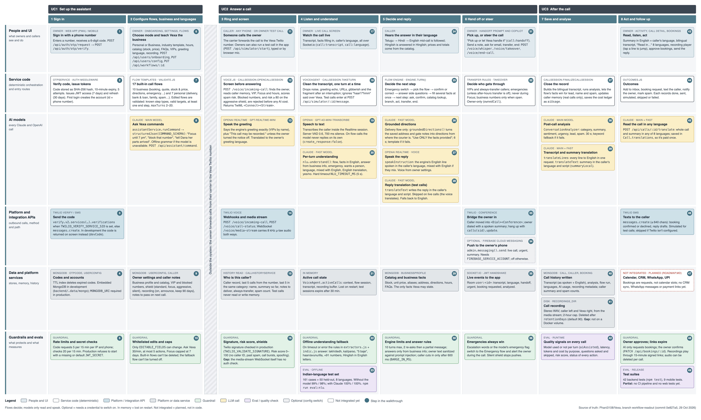
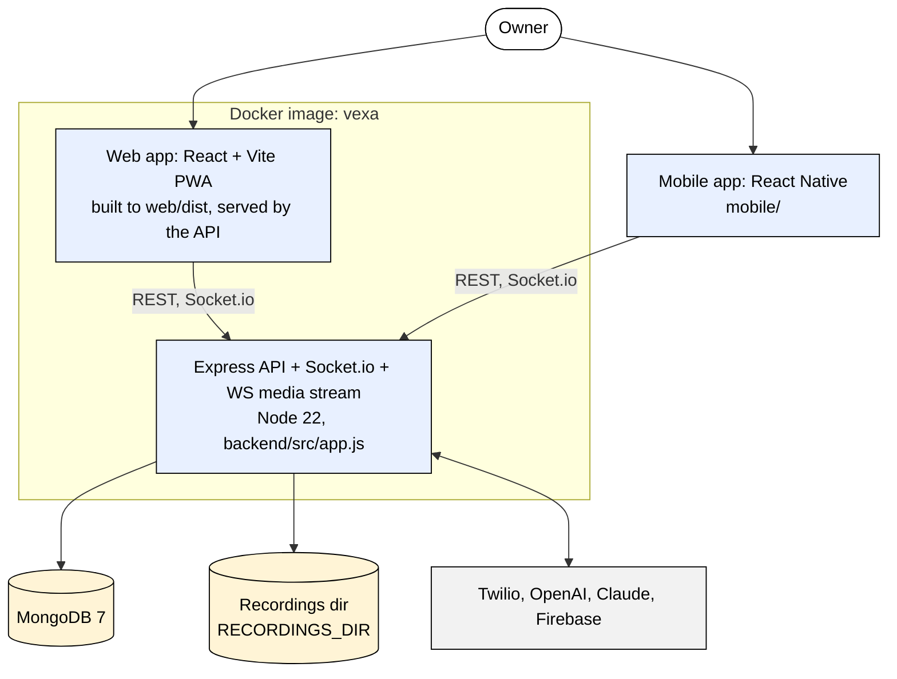
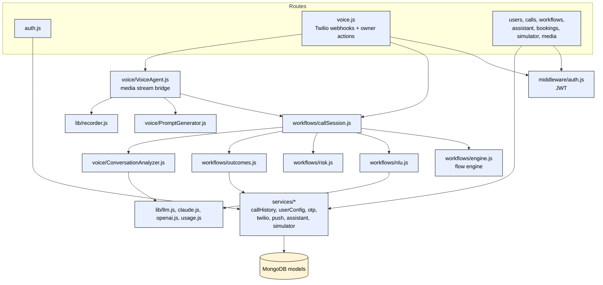
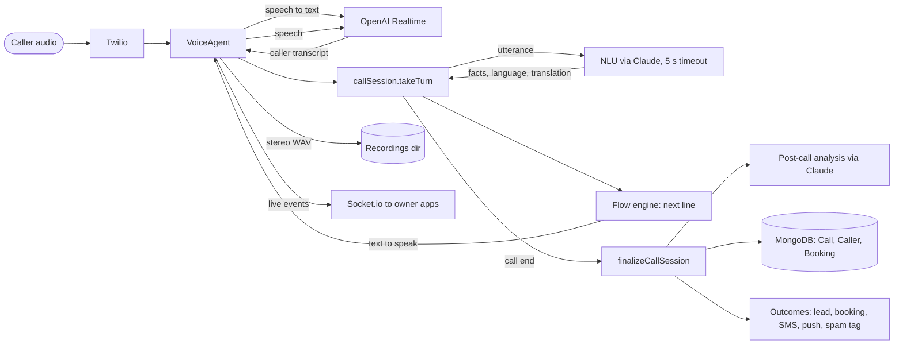
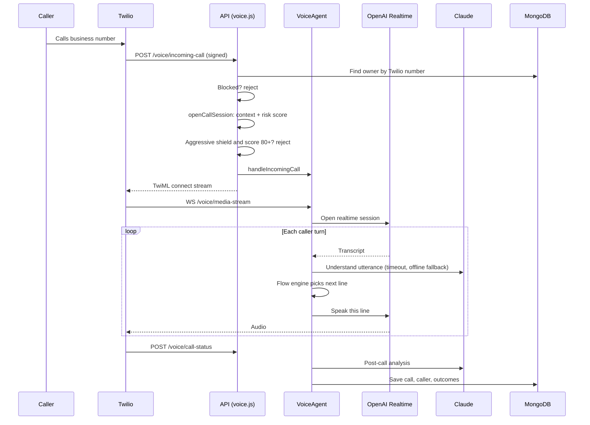
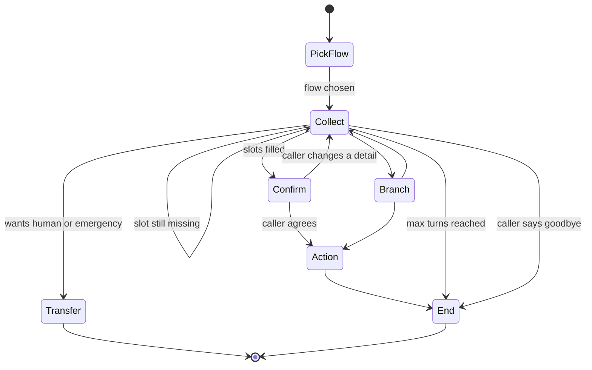
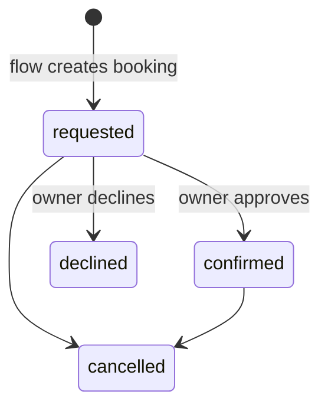
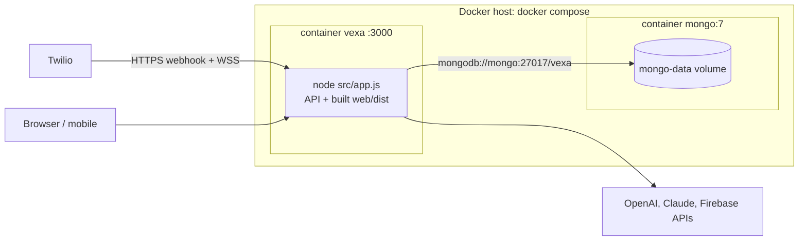
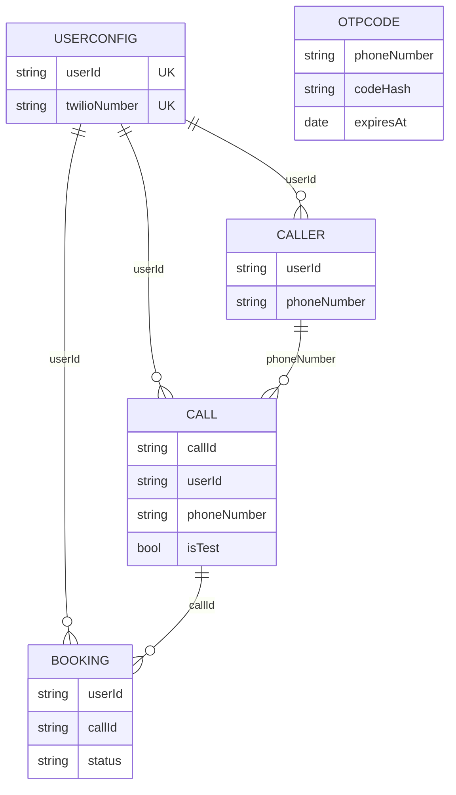

# 📞 Vexa — AI Receptionist for People and Small Businesses

Vexa answers your phone when you can't. It follows **multi-turn call flows** (quote, booking, emergency, delivery and others), understands callers in one sentence, answers their questions mid-call, and only interrupts you when it matters.

It works in two modes:
- **Personal**: screens unknown callers, handles deliveries, shuts down spam, and protects your focus time.
- **Business**: a receptionist that captures leads, takes booking requests, escalates emergencies and texts confirmations.

## Guardrails and evals

### Guardrails

| Guardrail | What it prevents | Where it is enforced | Default and flag |
|---|---|---|---|
| Login and tokens | Account takeover, code guessing | `otpService.js`, `middleware/auth.js` | Hashed codes, 10 min, 5 tries; JWT 7 d / 30 d; production requires `JWT_SECRET` |
| Rate limits | Abuse and runaway cost | `app.js`, `routes/auth.js`, `simulator.js`, `assistant.js` | API 600/15 min; codes 5/15 min; test calls 40/min; commands 30/min; outbound calls 10/min (in memory) |
| Owner isolation | One owner seeing another's calls | Every query scoped by `req.userId`; `ownedCall()` for live calls | On |
| Twilio signature | Forged call webhooks | `routes/voice.js` `twilioWebhook` | On in production; `TWILIO_VALIDATE_SIGNATURE` |
| Call audio stream token | A stranger opening a call's audio socket and driving the AI | `lib/streamToken.js`, `VoiceAgent.handleMediaStream` | On (single-use, 2-minute, bound to the call id); socket closed if no valid start within 5 s; `STREAM_AUTH=off` ignored in production |
| Spam screening | Robocalls and spoofing reaching the owner | `workflows/risk.js`, `routes/voice.js` | Risk 0–100; blocked numbers rejected; aggressive shield rejects ≥ 80 |
| Flow validation | Broken, looping or dead-end flows | `workflows/validate.js` | Known steps only, valid targets, end step required, `maxTurns` 2–20 |
| Engine limits | Endless calls | `workflows/engine.js` | 10 turns, 2 re-asks, 50-step loop guard; partial message saved |
| Emergency override | Missing a real emergency | `engine.js` emergency switch, `callSession.js` urgent alert | Escalation words + model flag; owner alerted mid-call |
| Who gets through | Interruptions the owner didn't want | `engine.js` `transfer_allowed` | VIP / always-transfer / emergency; never in Focus; business hours |
| Human approval | AI committing the owner | `outcomes.js`, `PATCH /api/bookings/:id` | Bookings are requests until the owner confirms |
| Grounded answers | Made-up prices, hours or directions | `nlu.js`, `callSession.js` directions prompt, `PromptGenerator.js` | "Answer ONLY from" business info; catalog for prices |
| Prompt-injection sanitizer | Owner or caller text taking over prompts | `PromptGenerator._sanitize` | Strips "ignore previous instructions", "system prompt" and similar |
| Model failure fallbacks | A slow or refusing model stalling a call | `nlu.js`, `translate.js`, `claude.js`, `ConversationAnalyzer.js` | Hard timeouts; offline rules; English; keyword analysis; refusal fallback (`ANTHROPIC_FALLBACKS`) |
| Transcript filters | Acting on noise or echoes | `VoiceAgent.js` transcript handler | Noise, echo, URL, gibberish, post-interruption fragments dropped; backchannels ignored |
| Recording consent and retention | Recording without notice; keeping audio forever | `callSession.js`, `media.js` | Notice on; 90 days; per-call delete; 15-minute signed links |
| Dev-only routes | Demo data in production | `users.js`, `media.js` | Off in production unless `ENABLE_DEMO_DATA=true` |
| Secrets | Keys leaking through the repo or logs | `backend/.env` (git-ignored), `.dockerignore`, `lib/redact.js` | Only `.env.example` is tracked; every log line scrubbed of API keys and bearer tokens |
| Test-call isolation | Rehearsals polluting real data | `simulatorService.js`, `callHistoryService.js`, `outcomes.js` | No caller memory, no real SMS |

### Evals and quality gates

| Eval | What it measures | When it runs | Threshold | Status |
|---|---|---|---|---|
| Indian-language understanding set (`backend/eval/nlu`) | Language, code-mixing, facts, yes/no, phone numbers across 8 languages (161 cases) | Every change in CI (offline, `--min 0.97`); `-- --mode claude` on demand | ≥ 97% offline (CI gate); ≥ 90% mixed-language target | Live · offline 99%, Claude 100% (157-case run) |
| Held-out set (`holdout.jsonl`) | Same, 50 new phrasings never tuned against | Every change in CI (`--min 0.95`) | Should track the main set | Live · offline 98%, Claude 100% |
| Backend unit tests | Flows, extractors, emergency, shields, Focus, sanitizer, recorder, Indian numbers/dates/yes-no, stream-token and log-redaction security | `npm test` before release | All pass | Live · 47 tests passing, run in CI |
| Mobile tests | App render, API client, transcript store | `jest` in `mobile/` | All pass | Partial · 9 tests |
| Web app checks | Type safety and build | `tsc -b && vite build`, `oxlint` | No errors | Partial · no unit tests |
| Runtime quality signals | Model used per turn, latency, tokens and cost by purpose, questions asked/skipped, risk, action status | Every call (saved on the call) | — | Live |
| Per-flow stats | Runs, completed, transferred, average turns and questions (30 days) | `GET /api/workflows` | — | Live |
| Speech eval on real Indian voices | Word error rate, language detection, facts from audio, reply latency | Planned (Phase 1B/1C) | ≥ 95% facts clean, ≥ 90% noisy, ≤ 1.5 s p95 | Planned |
| CI pipeline | Backend tests, understanding gate, web lint and build, Docker build, dependency audit | GitHub Actions on every push and pull request (`.github/workflows/ci.yml`) | All jobs green | Live |

---

## Vexa — end-to-end workflow

How an owner sets Vexa up, how every call is answered, understood and acted on, and what happens after it ends. Each box names the exact code path, model, API or data store involved; numbered badges match the step-by-step walkthrough below.



<sub>Source of truth: Phani3108/Vexa, branch launch-l0 (commit 10c45ad, 29 Oct 2026) · Full readout with every table: [docs/workflow/readout.html](docs/workflow/readout.html) (open locally or download).</sub>

| | |
|---|---|
| **Scope** | UC1 Set up the assistant · UC2 Answer a call (live phone calls and in-app test calls) · UC3 After the call. Personal and Business modes share the same pipeline. |
| **Source of truth** | github.com/Phani3108/Vexa · branch `launch-l0` · commit `10c45ad` · 29 Oct 2026 · backend/src, web/src, backend/.env.example, Dockerfile, docker-compose.yml, .github/workflows, backend/test, backend/eval |
| **Planned items** | From ROADMAP.md (India-first plan): Indian speech engines and voices, Indian phone number, WhatsApp, UPI, calendar and CRM. Drawn as Not integrated. |
| **Live status** | Text understanding, flows, analysis, translation and the app run end to end today. The live phone path (Twilio + OpenAI Realtime) is complete in code but has not been run on a real call: no Twilio or OpenAI keys are configured. |
| **Prepared by** | Phani Marupaka with Claude Code · 29 Oct 2026 |

### The flow, step by step

_Numbers match the badges in the diagram._

**UC1 · Sign in**

1. The owner opens the Vexa app (installable web app, or the mobile app) and enters a phone number. The app calls `POST /api/auth/otp/request`, then `POST /api/auth/otp/verify` with the 6-digit code.
2. The server stores only a hash of the code, accepts it for 10 minutes and allows 5 tries. A correct code returns a 7-day access token and a 30-day refresh token. The first login creates the account.
3. The code is sent by Twilio Verify, or as a plain Twilio SMS. In development no SMS is sent and the code is shown on screen.
4. Codes and accounts live in MongoDB. Expired codes delete themselves.
5. Rate limits stop code guessing and SMS abuse, and production will not start with a weak signing secret.

**UC1 · Configure flows, business and languages**

6. The owner picks Personal or Business, an industry template, opening hours, a product catalog with stock and prices, FAQs, VIP contacts, the greeting language and recording settings.
7. Vexa ships 17 ready-made call flows. Owners can edit them step by step; every edit is checked before it is saved, so a flow can't loop or dead-end.
8. Owners can also just say what they want ("I'm busy until 7 pm", "block that number"). Claude turns that into actions; a rule-based parser takes over if Claude is unavailable.
9. Settings, the catalog, shields and notes for specific callers are stored in MongoDB.
10. Only approved fields can be edited, commands are rate-limited and capped, and the built-in safety flows can't be removed.

**UC2 · Ring and screen**

11. A caller dials the owner. The owner's carrier forwards the call to the Vexa Twilio number. Owners can rehearse the same pipeline with an in-app test call.
12. Before answering, Vexa finds the owner, recalls the caller, checks VIPs, Focus and business hours, and scores spam risk. Blocked or very risky callers are rejected before any AI cost. Twilio is told to stream the audio to Vexa.
13. The OpenAI Realtime voice speaks the greeting written by the flow engine, including the recording notice.
14. Twilio sends call events to Vexa's webhooks and streams the audio in both directions over a WebSocket.
15. Caller history is read: their name, what past calls were about, any note the owner left for them, and whether they are usually spam.
16. Twilio signatures are verified in production, and the call's audio stream is only accepted with a single-use token signed for that exact call. The risk score and the owner's shield decide how strict to be.

**UC2 · Listen and understand**

17. The owner can watch the call live: the transcript, the facts Vexa has captured and the caller's language.
18. Each caller sentence is cleaned (noise, echoes and false starts are dropped) and processed in order, one turn at a time.
19. OpenAI turns the caller's speech into text. On flow calls the voice model never answers on its own; the flow engine decides every reply.
20. Claude reads each sentence and returns structured facts in English: which flow, names, dates, quantities, any question, an emergency, the language and an English translation. It has 5 seconds.
21. The live call's state is kept in server memory and is lost if the server restarts.
22. If Claude is slow or down, built-in rules understand Indian numbers, dates, yes/no and phone numbers in eight languages, so the call keeps going.
23. This understanding is measured on 211 test sentences in eight languages, including 50 held back from tuning.

**UC2 · Decide and reply**

24. The caller hears the answer in the language they are using right now, even when they switch mid-call.
25. The flow engine, not the model, decides what happens next: switch to emergency, confirm, answer a side question, look up stock and price, transfer or end. Several facts can be captured from one sentence.
26. For deliveries, Claude writes directions to the owner's home from the courier's location, using only the saved address and gate notes.
27. The voice speaks the engine's line in the caller's language, mixing in English the way the caller does.
28. On test calls, Claude translates the reply in text; on live calls the voice does it, which saves a request.
29. Prices, stock, hours, address and FAQs come from the owner's profile, so Vexa never guesses a number.
30. Calls are capped at 10 turns, unanswered questions end in a message for the owner, and answers are limited to the owner's own business information.

**UC2 · Hand off or steer**

31. When a call needs the owner, their app asks "pick up, or let Vexa handle it?". During any call the owner can send Vexa a note, ask it to collect an email, transfer or end the call.
32. Clear rules decide who gets through: VIPs and chosen callers, emergencies, nobody during Focus, and business calls only during opening hours.
33. To transfer, Twilio moves the caller into a conference and calls the owner with a short spoken summary first.
34. Push notifications go to the owner's phone through Firebase, when it is configured.
35. All live updates reach the owner's app over an authenticated Socket.io connection.
36. Emergencies always override other settings and alert the owner while the call is still going.

**UC3 · Save and analyse**

37. When the call ends, Vexa builds a transcript with every line as spoken plus English, saves the outcome, updates what it knows about the caller and records the exact AI cost.
38. Claude summarises the call: category, summary, urgency, whether it is a lead or spam.
39. Claude translates the transcript into English and writes the summary in the caller's language too.
40. Everything is saved in MongoDB as the call history that future calls draw on.
41. The recording is saved as a stereo audio file (on a persistent volume in Docker) and deleted automatically after the owner's retention period.
42. Every call carries quality signals: whether the model was used each turn, latency, tokens and cost by purpose, and how many questions were skipped.

**UC3 · Act and follow up**

43. The owner reads the call in English and the caller's language, listens to the recording, approves bookings and sends a reply.
44. Each outcome (inbox, booking request, text, alert, spam tag) is recorded with whether it was done, simulated or skipped.
45. The owner can read any call in any of the eight languages; the translation is saved, so it is paid for once.
46. Confirmation texts and replies go out by Twilio SMS. Test calls only simulate them.
47. Calendar booking, CRM sync, WhatsApp and UPI payment links are planned, not built.
48. A person approves every booking, and recordings can only be played through short-lived links.
49. Every change runs 47 backend tests, the understanding test gate, the web build and the Docker build in CI; 9 mobile tests also exist.

<details><summary><b>Data and history calls</b></summary>

What Vexa reads and writes about past calls, callers and the owner, and what is lost or not integrated.

| Source | Read or written | When | Notes |
|---|---|---|---|
| Caller memory (`Caller`, last 5 calls by number, last 5 in category) | Read | Start of every call (`getCallerContext`) | Name, running summary (600 chars), notes to deliver, always-transfer, spam and short-call counts. Test calls excluded. |
| Caller memory update | Written | End of every real call (`_updateCallerProfile`) | Appends to the summary; one-time notes are removed once delivered. Test calls never write. |
| Owner config (`UserConfig`) | Read | Every call and turn | Business profile, catalog, hours, FAQs, VIPs, blocked numbers, shield, Focus times, recording settings, flows. |
| Call record (`Call`) | Written | End of call (`saveCall`) | Transcript as spoken + English, analysis, local-language summary, flow run, languages, AI usage, recording metadata, follow-up status. |
| Bookings (`Booking`) | Written / updated | Booking flow; owner approval | Status requested → confirmed / declined; customer is texted. |
| Recordings (disk) | Written / read / deleted | Live calls; playback; every 6 h sweep | Stereo WAV in `RECORDINGS_DIR`, signed 15-minute playback links, retention default 90 days. |
| Translations cache (`Call.translations`) | Written / read | "Read in…" on call detail | Saved per language so repeat views cost nothing. |
| Active calls, test sessions, translation cache, rate-limit counters | In memory | During calls | Lost on restart; a single server instance only (no Redis store). |
| Redis (`config/redis.js`) | Not used | — | Client defined but never imported. |
| Calendar, CRM, WhatsApp, UPI, Indian telephony | Not integrated | — | Planned in ROADMAP.md. |

</details>

<details><summary><b>LLM calls</b></summary>

Claude is used for all text intelligence when `ANTHROPIC_API_KEY` is set (OpenAI chat is the fallback provider). OpenAI Realtime handles live speech. Every Claude call is metered per call (tokens, cost, latency).

| Call (function) | Model | When it runs | What it produces | Switch / flag |
|---|---|---|---|---|
| Per-turn understanding · `nlu.understand()` | Claude fast model (`ANTHROPIC_FAST_MODEL`, else `ANTHROPIC_MODEL` = claude-opus-5-5) · low effort · 2,048 tokens | Every caller sentence | Flow, facts in English, answer from business info, emergency, wants a person, goodbye, language, code-mixing, English translation, yes/no | `NLU_TIMEOUT_MS` (5 s), `NLU_DISABLED` |
| Reply translation · `translateText()` | Claude fast model · 2,000 tokens | Test calls, greeting, owner notes | Reply in the caller's language and script (mixed if they mix) | Off on live calls (voice translates) |
| Transcript translation · `translateLines()` | Claude main model · 8,000 tokens · 30 s | End of call; "Read in…" | Every line in English (or the chosen language) | — |
| Summary translation · `translateText()` | Claude fast model · 20 s | End of call; "Read in…" | Summary in the caller's language and native script | — |
| Grounded directions · `groundedDirections()` | Claude fast model · 1,500 tokens · 6 s | Delivery flow, once | Directions from the courier's location using only saved facts | Template fallback |
| Post-call analysis · `ConversationAnalyzer.analyze()` | Claude main model · 4,096 tokens · 30 s | End of every call | Category, summary, sentiment, urgency, lead, spam, action items | Keyword fallback |
| Ask Vexa · `assistantService.runCommand()` | Claude main model · 2,048 tokens · 10 s | Owner commands | Up to 5 actions: shield, block, VIP, always-transfer, note, flow on/off, brief | Rule parser fallback |
| Speech to text | OpenAI `gpt-4o-mini-transcribe` (in Realtime) | Live calls | Caller transcript | `OPENAI_API_KEY` |
| Voice (speech in, speech out) | OpenAI Realtime `OPENAI_DEPLOYMENT_NAME` (gpt-realtime-mini) · voice shimmer by default | Live calls | Speaks the engine's lines in the caller's language; free conversation only when no flow is active | `OPENAI_API_KEY`, `OPENAI_ENDPOINT` (Azure) |
| Text fallback provider · `chatCompletion()` | OpenAI `OPENAI_CHAT_DEPLOYMENT` (gpt-4.1-mini) | Only if no Anthropic key | Same JSON outputs as above | `OPENAI_API_KEY` |

</details>

<details><summary><b>Embedding models</b></summary>

| Model | Used for | Where it runs |
|---|---|---|
| None | Vexa uses no embeddings or vector store. Knowledge is the owner's own structured profile, passed to Claude directly. | — |

</details>

<details><summary><b>API calls and integrations</b></summary>

| System | Call | Purpose | Auth |
|---|---|---|---|
| Anthropic | `client.beta.messages.create` (structured JSON output; server-side refusal fallback beta) | All text intelligence above | `ANTHROPIC_API_KEY` |
| OpenAI / Azure OpenAI | WSS `/v1/realtime` (or Azure `/openai/realtime`); `POST /chat/completions` fallback | Live speech; text fallback | `OPENAI_API_KEY` (Bearer or `api-key`) |
| Twilio Voice (inbound) | `POST /voice/incoming-call`, `/voice/call-status`, `/voice/takeover-status`, `/voice/outbound-twiml`; WSS `/voice/media-stream` | Answer, screen, stream audio | Twilio request signature (production) |
| Twilio Voice (outbound) | `calls.create`, `calls(sid).update`, `<Dial><Conference>` | Owner callback, hang up, transfer | `TWILIO_ACCOUNT_SID`, `TWILIO_AUTH_TOKEN` |
| Twilio SMS / Verify | `messages.create`; `verify.v2.services(…).verifications` | Login codes, booking texts, replies | Same, plus `TWILIO_VERIFY_SERVICE_SID` |
| Firebase Cloud Messaging | `admin.messaging().send` | Push notifications | `FIREBASE_SERVICE_ACCOUNT` (optional) |
| Vexa API (owner app) | `/api/auth/*`, `/api/users/*`, `/api/calls/*`, `/api/workflows/*`, `/api/assistant/*`, `/api/bookings/*`, `/api/simulator/*`, `/media/recordings/:token` | Everything the app does | JWT bearer; recording via signed link |
| Socket.io | Events `call:transcript`, `call:language`, `call:handoff`, `call:urgent`, `call:analyzed`, `booking:requested` | Live updates to the owner | JWT in handshake |

</details>

<details><summary><b>Tech stack</b></summary>

| Layer | Components and versions |
|---|---|
| Backend | Node.js ≥ 20 (22 in Docker), Express 5.2, Mongoose 8.23, Socket.io 4.8, ws 8, helmet 8, express-rate-limit 8, jsonwebtoken 9, winston 3, axios 1 |
| AI | @anthropic-ai/sdk 0.131 (Claude Opus 5.5 by default, optional fast model e.g. Haiku 4.5); OpenAI Realtime (gpt-realtime-mini, gpt-4o-mini-transcribe); OpenAI chat gpt-4.1-mini as fallback |
| Telephony and messaging | twilio 5.12 (Voice, Media Streams, Conference, SMS, Verify); firebase-admin 13.8 (push) |
| Data | MongoDB 7 (Docker) or embedded mongodb-memory-server 11 in development; recordings on local disk |
| Web app | React 19, React Router 7, Vite 8, TypeScript 6, lucide-react, socket.io-client 4.8; installable PWA (manifest + service worker) |
| Mobile app | React Native 0.84, React 19.2, React Navigation 7 (uses the same API) |
| Deploy | Multi-stage Dockerfile (node:22-alpine) serving API + web; docker-compose with mongo:7 |
| Demo and evals | playwright-core 1.63, macOS speech synthesis, Swift AVFoundation encoder; node:test; custom NLU eval runner |

</details>

<details><summary><b>Switches</b></summary>

| Env flag | Effect | Default |
|---|---|---|
| `ANTHROPIC_API_KEY` | Turns on Claude for all text intelligence | Unset → OpenAI chat, else offline rules |
| `ANTHROPIC_MODEL` | Main model (analysis, translation, commands) | claude-opus-5-5 |
| `ANTHROPIC_FAST_MODEL` | Model for per-turn understanding, reply translation, directions | Same as main |
| `ANTHROPIC_FALLBACKS` | Server-side refusal fallback | On (`off` disables) |
| `NLU_TIMEOUT_MS` / `NLU_DISABLED` | Per-turn model budget / switch the model off | 5000 ms / on |
| `OPENAI_API_KEY`, `OPENAI_ENDPOINT`, `OPENAI_DEPLOYMENT_NAME` | Live voice (Azure if endpoint set) | Unset → live voice off; gpt-realtime-mini |
| `TWILIO_ACCOUNT_SID` / `TWILIO_AUTH_TOKEN` / `TWILIO_PHONE_NUMBER` | Live calls, SMS, OTP | Unset → app and test calls only |
| `TWILIO_VERIFY_SERVICE_SID` | OTP via Twilio Verify | Unset → plain SMS |
| `TWILIO_VALIDATE_SIGNATURE` | Force webhook signature checks | On in production |
| `WEBHOOK_URL` | Public base URL for Twilio | http://localhost:3000 |
| `BARGE_IN_MS` | How long a caller must talk over Vexa to interrupt | 600 ms |
| `DEFAULT_COUNTRY_CODE` | Country for 10-digit spoken numbers | +91 |
| `RECORDINGS_DIR` | Where recordings are stored | backend/.data/recordings |
| `FIREBASE_SERVICE_ACCOUNT` | Push notifications | Unset → off |
| `MONGODB_URI` | Database | Embedded in development; required in production |
| `JWT_SECRET`, `JWT_EXPIRES_IN`, `JWT_REFRESH_EXPIRES_IN` | Token signing and lifetimes | Required in production; 7 d; 30 d |
| `ENABLE_DEMO_DATA` | Demo routes in production | Off |
| `OTP_FORCE_SMS` | Send real codes in development | Off |
| `STREAM_TOKEN_SECRET` | Signs the per-call audio stream token | Derived from `JWT_SECRET` |
| `MIN_APP_VERSION` / `LATEST_APP_VERSION` | Android app forced / suggested update | Unset |

</details>

<details><summary><b>Known gaps (from the code)</b></summary>

- The live phone path (Twilio + OpenAI Realtime) is complete in code but has not run on a real call; no keys are configured.
- Active calls, test sessions and rate-limit counters live in memory: one server instance only, and a restart drops live calls.
- Unused code and dependencies: `config/redis.js`, `pg`, `bcrypt`.
- Per-turn replies take 2–9 s on Opus; a fast model (e.g. Haiku) is recommended for live calls.

</details>

<sub>Regenerate: edit [docs/workflow/workflow.json](docs/workflow/workflow.json), then run the `workflow-readout` build.</sub>

---

## Highlights

| | |
|---|---|
| **Flow engine** | 17 editable playbooks (10 business, 7 personal). One sentence can fill several facts, so Vexa skips questions; it answers side questions and resumes; it switches to Emergency mid-call. The engine decides every step, the model only reads and speaks. |
| **Speaks your caller's language** | English, Hindi, Telugu, Tamil, Malayalam, Marathi, Gujarati, Spanish, with mid-call switching. Understands Hinglish and other languages typed in English letters, lakh/dedh, kal/parso, haan/avunu/illa, and replies the way the caller talks. |
| **Live call and Copilot** | Watch the transcript and captured facts live. Pick up from the handoff prompt, or send Vexa a note, ask for an email, transfer or end the call. |
| **Ask Vexa** | Plain-English commands: "Focus until 7 pm", "Always put Mom straight through", "Tell Dana her parts arrived" (delivered on her next call), "Block that number". |
| **Screening** | Standard, Focus, Spam shield and Silent modes; a spam risk score before the phone rings; VIPs and emergencies can break through. |
| **Outcomes** | Leads in your inbox, booking requests you approve with one tap (the caller is texted), live stock, price and totals from your catalog, urgent alerts during the call. |
| **After the call** | Summary in English and in the caller's language, transcript as spoken with English under each line, "Read in…" any of 8 languages, stereo recording with tap-to-jump. |
| **Cost on every call** | Exact Claude tokens and cost saved with each call: about $0.05 (₹4.34) per call in the demo, on Claude Opus 5.5. |

## Demo

▶ [demo/output/vexa-demo.mp4](demo/output/vexa-demo.mp4) · 18 min · [subtitles](demo/output/vexa-demo.srt) · [cost of each call](demo/output/COSTS.md). Every call in it was handled live by Claude; the voices are synthesized.

- Personal: a courier guided to the door and handed to you for the OTP, a bank loan call negotiated from 14% to 12.5%, Amma told you're free after 7 PM.
- Business: a booking, directions and Sunday hours, stock with price and total.
- Languages: Telugu → Hindi → English in one call, a Hinglish caller, six more languages, then the bilingual transcript, "Read in Gujarati" and the recording.

<details><summary>Rebuild the video</summary>

With the backend running: `node demo/run-scenarios.mjs`, `node demo/attach-recording.mjs`, `node demo/capture-screens.mjs`, `node demo/build-timeline.mjs`, `node demo/make-data.mjs`, `node demo/write-costs.mjs`, `node demo/render-frames.mjs`, then `swift demo/encode.swift demo/build/frames 12 demo/build/audio/mix.wav demo/output/vexa-demo.mp4`.

</details>

## Quick start (local, zero config)

```bash
cd backend && npm install && npm run dev      # API on :3000, embedded MongoDB starts automatically
cd web && npm install && npm run dev          # phone app on :5173
```

1. Open http://localhost:5173 and sign in with any phone number (in development the code is filled in; no SMS is sent).
2. Pick **Just me** or **My business** and finish setup. You land on a **test call**: type or speak as the caller.
3. On **Home**, tap **Load sample calls**, then explore Activity, a call's detail, Flows and Ask Vexa (the centre orb).

- **No AI key:** offline rules detect all 8 languages and pick up names, dates, numbers and yes/no; the engine still runs every flow. Free-form understanding needs Claude.
- **`ANTHROPIC_API_KEY` in `backend/.env`:** Claude handles understanding, translation and post-call analysis. For faster turns, add `ANTHROPIC_FAST_MODEL=claude-haiku-4-5`.
- **One server:** `cd web && npm run build`, then `cd backend && npm start` serves the app at http://localhost:3000.
- **Checks:** `cd backend && npm test && npm run eval:nlu`.

## Going live with real calls

1. In `backend/.env` (see `.env.example`): `ANTHROPIC_API_KEY`, `OPENAI_API_KEY` (live voice), `TWILIO_ACCOUNT_SID` / `TWILIO_AUTH_TOKEN` / `TWILIO_PHONE_NUMBER`, `WEBHOOK_URL`, `MONGODB_URI`, `JWT_SECRET`.
2. Point the Twilio number's voice webhook to `https://YOUR-SERVER/voice/incoming-call`.
3. Forward your phone to the Twilio number. **Me → Phone setup** shows the codes (GSM `*004*<number>#`, Verizon `*71<number>`).
4. Deploy: `JWT_SECRET=$(openssl rand -hex 32) docker compose up --build` (API, web app and MongoDB).

The live phone path is complete in code but has not yet run on a real call: place test calls before onboarding customers.

## Project layout

```
backend/
  src/workflows/    flow engine, templates, extractors, NLU, risk score, outcomes
  src/voice/        live calls: VoiceAgent (Twilio ↔ OpenAI Realtime), prompts, post-call analysis
  src/services/     calls, user config, OTP, test calls, Ask Vexa, Twilio, push
  src/lib/          Claude client, translation, languages, Indian-language rules, recorder, cost ledger
  src/routes/       REST API and Twilio webhooks
  test/             unit tests (npm test)
  eval/nlu/         Indian-language understanding eval (npm run eval:nlu)
web/                React + Vite phone app (installable PWA)
mobile/             React Native client on the same API (predates flows, Copilot and Ask Vexa)
docs/workflow/      CEO workflow readout: workflow.json (source), workflow.png, readout.html
demo/               demo recording pipeline and the video
```

## API reference

| Area | Endpoints |
|---|---|
| Auth | `POST /api/auth/otp/request`, `POST /api/auth/otp/verify`, `POST /api/auth/refresh`, `GET /api/auth/me` |
| Account | `GET/PUT /api/users/config`, `POST /api/users/onboarding`, `POST /api/users/mode`, `GET /api/users/templates`, categories, VIPs, blocked numbers, priority time |
| Calls | `GET /api/calls` (`q`, `category`, `followUp`, `leads`, `includeTest`), `GET /api/calls/stats`, `GET /api/calls/callers`, `GET/DELETE /api/calls/:id`, `PATCH /api/calls/:id/follow-up`, `GET /api/calls/:id/reply-draft`, `POST /api/calls/:id/sms` |
| Recording and languages | `GET /api/calls/:id/recording-link` (15-min signed link to `GET /media/recordings/:token`), `DELETE /api/calls/:id/recording`, `POST /api/calls/:id/translate` `{ lang }` |
| Flows | `GET/POST /api/workflows`, `PUT/PATCH/DELETE /api/workflows/:id`, `POST /api/workflows/reset` |
| Ask Vexa and bookings | `GET /api/assistant/brief`, `POST /api/assistant/command`, `PUT /api/assistant/shield`, `GET /api/bookings`, `PATCH /api/bookings/:id` |
| Test calls | `POST /api/simulator/start`, `/:id/message`, `/:id/whisper`, `/:id/end` |
| Mobile context | `POST /api/context/outgoing-call`, `GET/PUT /api/context/caller/:phoneNumber`, `GET/PUT /api/context/user-profile`, `GET /api/context/summary` |
| Voice | Twilio webhooks `POST /voice/incoming-call`, `/voice/call-status` (signature-checked in production); owner actions `POST /voice/takeover`, `/voice/whisper`, `/voice/end-call`, `/voice/outbound-call` |

All routes need `Authorization: Bearer <token>` except sign-in (`/api/auth/otp/*`, `/api/auth/refresh`), `GET /api/meta`, `GET /health`, Twilio webhooks and signed recording links. Socket.io connects with `io(url, { auth: { token } })`.

Plans: [ROADMAP.md](ROADMAP.md).

## Production Readiness

Review date: 2026-10-26. Reviewer: Claude Code, for Phani Marupaka. Scope: repo at commit `a5b69c5` on `main`. Source: repo files only. Method: `.claude/skills/project-completion-gate/SKILL.md`.

- Backend unit tests ran in this review: `cd backend && npm ci && npm test` gave 36 pass, 0 fail (`backend/test/*.test.js`).
- Not run in this review: web build, mobile tests, Docker build, any live Twilio or OpenAI call.

### Verdict: Not ready

- Rule from the gate: Ready needs no Missing on Guardrails, Security or Human in the loop, and evals must gate the release.
- No dimension is Missing on Guardrails, Security or Human in the loop. All three are Partial, with gaps listed below.
- Evals do not gate a release: no CI exists (`.github/`: Not found in repo).
- Blockers, in order:
  1. No CI or release gate. Tests are never run automatically.
  2. No per-call duration or cost ceiling on live calls.
  3. Live voice path not run end to end (`ROADMAP.md`, "Known gaps").
  4. No dependency or container scanning, no `SECURITY.md`.
  5. No tracing, error alerting or cost alerting.

### Scorecard

| Dimension | Status | Main evidence |
|---|---|---|
| Guardrails | Partial | `backend/src/workflows/engine.js`, `backend/src/voice/PromptGenerator.js`, `backend/src/app.js` |
| Evals | Partial | `backend/test/*.test.js` |
| Observability | Partial | `backend/src/config/logger.js`, `backend/src/lib/usage.js` |
| Security | Partial | `backend/src/middleware/auth.js`, `backend/src/routes/voice.js` |
| Human in the loop | Partial | `backend/src/routes/assistant.js`, `backend/src/routes/voice.js` |
| Architecture diagrams | Present (this section) | Derived from the files cited under each diagram |

### 1. Guardrails: Partial

Present:
- Request size and rate limits: JSON body 1 MB, `/api/` 600 per 15 min, `/voice/outbound-call` 10 per min, simulator 40 per min, Ask Vexa 30 per min, OTP request and verify limiters (`backend/src/app.js`, `backend/src/routes/simulator.js`, `backend/src/routes/assistant.js`, `backend/src/routes/auth.js`).
- Prompt-injection handling for owner-supplied text: `_sanitize` strips markdown characters and replaces known phrases such as "ignore previous instructions" (`backend/src/voice/PromptGenerator.js`). It is a phrase list, not a full defence.
- Flow engine decides each reply; the realtime model only speaks it (`create_response: false`, per `ROADMAP.md`). Flows are validated before use (`backend/src/workflows/validate.js`).
- Turn cap per flow: `maxTurns`, clamped to 2-20, default 10 (`backend/src/workflows/validate.js`, `backend/src/workflows/engine.js` line 675).
- Output schema: Claude calls use `json_schema` structured output (`backend/src/lib/claude.js`).
- Fallback: NLU timeout (`NLU_TIMEOUT_MS`, default 5000 ms) falls back to the offline extractors (`backend/src/workflows/nlu.js`). Claude client uses `maxRetries: 1`.
- Allow-listed actions: `create_lead`, `book_request`, `send_sms`, `notify_owner`, `tag_spam` (`backend/src/workflows/validate.js`, `backend/src/workflows/outcomes.js`).

Gaps and what can go wrong:
- Per-call duration cap and per-call cost ceiling: Not found in repo (`TODO.md` section 9 lists them unchecked). A stuck or abusive call can run and bill until the caller or Twilio ends it.
- Caller speech is passed to the model as the user message in `backend/src/workflows/nlu.js`. Injection handling there rests on structured output only; `_sanitize` is not applied to it. A caller could try to steer extraction. Structured output limits the damage; it does not remove it.
- OpenAI fallback path: schema is described in the prompt only (`backend/src/lib/llm.js`). Output can fail to match the schema.
- PII filtering on output or on stored transcripts: Not found in repo. Transcripts hold whatever callers say.
- Voice-to-flow transfer is triggered by matching the phrase "transferring you now" in the AI's own words (`backend/src/voice/VoiceAgent.js` line 674). A paraphrase would not trigger a transfer.

Action: add a hard call-duration limit in `VoiceAgent` and a per-call cost ceiling using the ledger in `backend/src/lib/usage.js`.

### 2. Evals: Partial

Present:
- 36 backend tests with expected outcomes: engine conversations, extractors, Ask Vexa grammar, hours, multilingual (`backend/test/core.test.js`, `backend/test/workflows.test.js`, `backend/test/multilingual.test.js`). They passed in this review.
- Mobile tests: `mobile/__tests__/` (3 files). Not run in this review.
- Per-call cost and latency are recorded (`backend/src/lib/usage.js`), and sample costs are in `demo/output/COSTS.md`.

Gaps and what can go wrong:
- CI: Not found in repo (no `.github/`, no other CI config). A broken change can merge and ship unnoticed.
- Test set for model-backed behaviour (Claude extraction, translation, post-call analysis) with pass thresholds: Not found in repo. Tests cover the offline engine; model quality can regress silently.
- Judge calibration: Not applicable, no LLM grader found in repo.
- Web tests: Not found in repo (`web/package.json` has no test script).
- Tests run against the live voice path: Not found in repo. `ROADMAP.md` says the voice path has not been run end to end.

Action: add a GitHub Actions workflow that runs `npm test` in `backend/` and `web` build on every PR, and make it a required check.

### 3. Observability: Partial

Present:
- Winston logger, JSON format in production, file transports with rotation (`backend/src/config/logger.js`).
- Per-call AI usage ledger: tokens, cost, latency by purpose (`backend/src/lib/usage.js`).
- `/health` endpoint returns 503 when MongoDB is down (`backend/src/app.js`).
- Action results are stored on each call with a status (`backend/src/workflows/outcomes.js`).

Gaps and what can go wrong:
- Much of the code uses `console.log` (112 occurrences in `backend/src`) instead of the logger. Those lines are not JSON and not in the log files.
- Request or run IDs in logs: Not found in repo. Tracing one call across services means searching by hand.
- Traces and metrics export (OpenTelemetry, Prometheus, Sentry): Not found in repo (`ROADMAP.md` Phase 1 lists Sentry as open).
- Alerts on failure or cost spikes: Not found in repo. A failing voice path or a cost spike is seen only if someone reads the logs.
- Audit trail of who changed settings or flows: Not found in repo.

Action: replace `console.*` with the logger, add a call ID to each log line, and add Sentry as listed in `ROADMAP.md`.

### 4. Security: Partial

Present:
- Secrets via environment variables; `.env` is git-ignored; `backend/.env.example` has empty values. Production refuses to start without a strong `JWT_SECRET` (`backend/src/middleware/auth.js`).
- JWT on `/api/*` and on owner voice actions; refresh tokens rejected as access tokens; calls checked against the owner (`backend/src/middleware/auth.js`, `backend/src/routes/voice.js` `ownedCall`).
- Twilio signature check on webhooks, on by default in production (`backend/src/routes/voice.js`).
- Socket.io requires a JWT; the server picks the room (`backend/src/app.js`).
- OTP login: hashed codes, 10 min TTL, 5 attempts, rate limits (`backend/src/services/otpService.js`, `backend/src/routes/auth.js`).
- `helmet`, CORS allow-list in production, signed 15-minute recording links (`backend/src/app.js`, `backend/src/routes/media.js`).
- Recording retention 7-365 days, per-call recording delete, per-call delete (`backend/src/routes/media.js`, `backend/src/routes/calls.js`).
- Demo data and WAV upload are disabled in production unless `ENABLE_DEMO_DATA=true`.

Gaps and what can go wrong:
- `SECURITY.md`: Not found in repo. There is no stated way to report a vulnerability.
- Dependency or container scanning (Dependabot, `npm audit` in CI, image scan): Not found in repo. Known-vulnerable packages can ship.
- `backend/src/routes/webhooks.js` has unauthenticated POST routes (`/call-started`, `/call-ended`, `/transcript-update`) that trigger push notifications from request-body `userId`. The router is not mounted in `backend/src/app.js` today. If someone mounts it, anyone can send pushes to any user. Remove the file or add auth.
- `/voice/media-stream` WebSocket has no signature check in `backend/src/app.js`; it relies on the `callSid` matching an active call (`backend/src/voice/VoiceAgent.js` line 369). Not tested here.
- JWT lifetime is 7 days with no server-side revocation list (`backend/src/middleware/auth.js`). A leaked token works until it expires.
- Recording link secret falls back to the dev secret when `JWT_SECRET` is unset (`backend/src/routes/media.js`). Production startup blocks this through `auth.js`, so the risk is limited to non-production.
- CORS and Socket.io allow `*` outside production (`backend/src/app.js`).
- CSP is disabled in `helmet` (`contentSecurityPolicy: false`).
- Transcript retention: only recordings expire. Transcripts stay until the owner deletes a call. Account deletion endpoint: Not found in repo.
- `mobile/android/app/debug.keystore` is committed and used for the build config (`mobile/android/app/build.gradle`). It is the default debug key; the file comment says a release keystore is still to be created. Do not ship a release with it.
- Mobile token storage: not verified in this review (`mobile/src/services/api.ts` holds tokens in memory; persistence location not checked).
- Docker: container runs as root, no `HEALTHCHECK` (`Dockerfile`). `docker-compose.yml` publishes port 3000 and MongoDB has no authentication configured in the file.

Action: add `SECURITY.md`, enable Dependabot and `npm audit` in CI, delete or protect `backend/src/routes/webhooks.js`.

### 5. Human in the loop: Partial

Present:
- Booking requests need owner approval; the AI never confirms a slot (`backend/src/models/mongodb/Booking.js`, `backend/src/routes/assistant.js` `PATCH /api/bookings/:id`). The caller is texted after approval.
- Owner can take over a live call (`POST /voice/takeover`), steer it (`/voice/whisper`), or end it (`/voice/end-call`) (`backend/src/routes/voice.js`).
- Escalation: emergency flow, "wants human" flag, AI-triggered transfer to the owner or a front-desk number (`backend/src/workflows/nlu.js`, `backend/src/voice/VoiceAgent.js`).
- Shield modes, including Silent and Focus, and a spam score of 80 or more in Aggressive mode rejects the call (`backend/src/routes/voice.js`).
- Owner can turn flows off per account (`flowsDisabled`, `backend/src/routes/voice.js`).
- Follow-up inbox with status for leads (`backend/src/routes/calls.js`).

Gaps and what can go wrong:
- `send_sms` to the caller runs without owner approval (`backend/src/workflows/outcomes.js`). A wrong or unwanted text goes to a real number. Owner-set templates limit the content.
- Rejected high-risk calls (score 80+) are not placed in a review queue (`backend/src/routes/voice.js`). A real caller scored high is lost without a trace beyond a log line. Not verified whether the rejection is stored in call history.
- Reviewer decision record: booking status is stored; who changed it and when beyond `updatedAt` is Not found in repo.
- Global kill switch for all voice handling (not per account): Not found in repo.
- Low-confidence escalation: confidence is stored for category matching (`backend/src/models/mongodb/Call.js`); a rule that escalates on low confidence is Not found in repo.

Action: add an owner setting that requires approval for outbound SMS, and store rejected calls.

### 6. Architecture diagrams

All diagrams are derived from the files named under each one. Parts the code does not have are marked, not drawn.

Not drawn, code does not support them:
- Swimlane and waterfall diagrams: not in the requested set for this review.
- Multi-instance deployment: active calls are held in process memory (`backend/src/voice/VoiceAgent.js` `activeCalls`; `ROADMAP.md` "Known gaps"). `backend/src/config/redis.js` exists but no file imports it. Only a single instance is drawn.

#### C4 L1: System context

Source: `README.md`, `backend/src/routes/voice.js`, `backend/src/lib/llm.js`, `backend/src/services/pushNotificationService.js`.


#### C4 L2: Containers

Source: `docker-compose.yml`, `Dockerfile`, `backend/src/app.js`, `web/`, `mobile/`.



Note: in development MongoDB is embedded (`backend/src/config/mongodb.js`) and the web app runs on Vite port 5173.

#### C4 L3: Components of the API container

Source: `backend/src/app.js`, `backend/src/routes/`, `backend/src/voice/`, `backend/src/workflows/`, `backend/src/services/`, `backend/src/lib/`.



#### Data flow

Source: `backend/src/routes/voice.js`, `backend/src/workflows/callSession.js`, `backend/src/workflows/outcomes.js`.



#### Sequence: incoming call

Source: `backend/src/routes/voice.js` (`/incoming-call`), `backend/src/voice/VoiceAgent.js`, `backend/src/workflows/callSession.js`.



#### State machine: flow session

Source: `backend/src/workflows/engine.js`, `backend/src/workflows/validate.js` (step types: collect, confirm, say, branch, action, transfer, end, goto, lookup). The states below are the step types and end conditions; exact transitions inside `engine.js` are not all traced here.



#### State machine: booking

Source: `backend/src/models/mongodb/Booking.js` (status enum), `backend/src/routes/assistant.js` (PATCH accepts any of the four statuses from any state; no transition rules found).



Only `requested`, `confirmed`, `declined`, `cancelled` are in the code. The PATCH route does not restrict transitions, so the arrows above show the intended use, not an enforced rule.

#### Deployment

Source: `Dockerfile`, `docker-compose.yml`.



Not shown because not in the repo: reverse proxy or TLS termination, cloud hosting target, volume for recordings (the compose file mounts only `mongo-data`, so recordings in the container are lost on rebuild).

#### Entity relationship

Source: `backend/src/models/mongodb/*.js`. Links are by `userId` and phone number strings, not Mongo references.



### 7. README

Present: what it is, quick start, API overview (this file). Test command is in `backend/package.json`; the README does not state `npm test` in the quick start (it appears under "Project layout"). Not found in repo: CI badge, `.github/`.

### Open items register

| # | Item | Owner | Date |
|---|---|---|---|
| 1 | Add CI that runs backend tests and web build on every PR; make it a required check | Phani Marupaka | 2026-10-26 |
| 2 | Add call-duration limit and per-call cost ceiling | Phani Marupaka | 2026-10-26 |
| 3 | Run the live voice path end to end and record latency (`ROADMAP.md` Known gaps) | Phani Marupaka | 2026-10-26 |
| 4 | Add `SECURITY.md`, Dependabot and `npm audit` in CI | Phani Marupaka | 2026-10-26 |
| 5 | Delete or protect `backend/src/routes/webhooks.js` | Phani Marupaka | 2026-10-26 |
| 6 | Add call IDs to logs, replace `console.*` with the logger, add error and cost alerts | Phani Marupaka | 2026-10-26 |
| 7 | Add an eval set for Claude-backed extraction and analysis with a pass threshold | Phani Marupaka | 2026-10-26 |
| 8 | Add owner approval option for outbound SMS; store rejected high-risk calls | Phani Marupaka | 2026-10-26 |
| 9 | Add account deletion and transcript retention | Phani Marupaka | 2026-10-26 |
| 10 | Create a release Android keystore; stop using `debug.keystore` for release | Phani Marupaka | 2026-10-26 |
| 11 | Check `/voice/media-stream` WebSocket handling when no matching call exists | Phani Marupaka | 2026-10-26 |
| 12 | Decide on mobile app: keep React Native or move to the PWA (`ROADMAP.md` recommends Capacitor) | Phani Marupaka | 2026-10-26 |

Owner is Phani Marupaka for all items; the repo names no other owner. Dates are the review date; the repo gives no due dates, so each owner should set a real date.

## License

MIT, as declared in `backend/package.json`.
