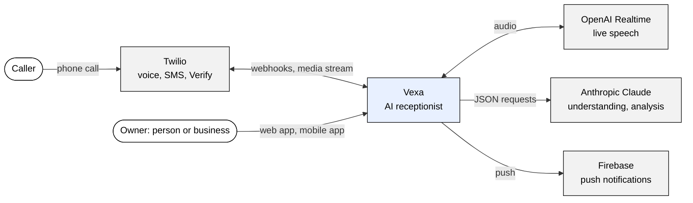
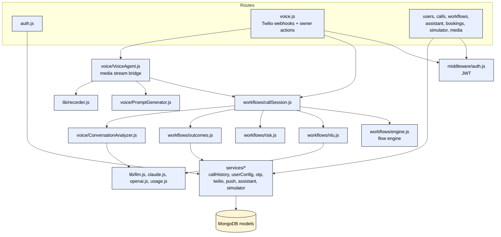
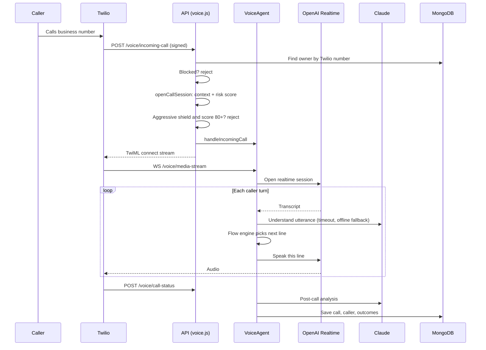
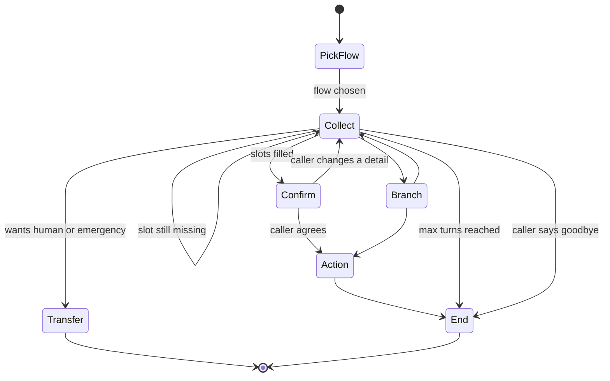
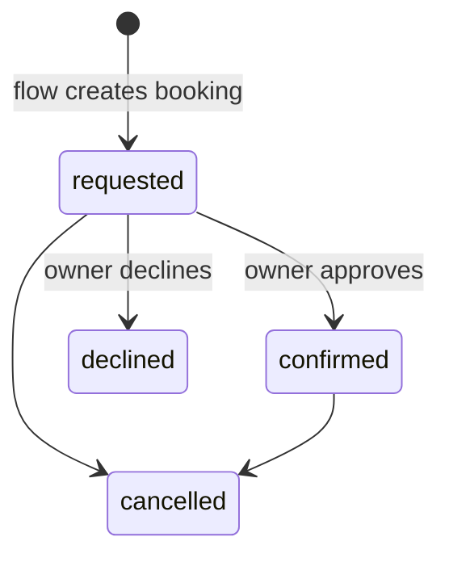
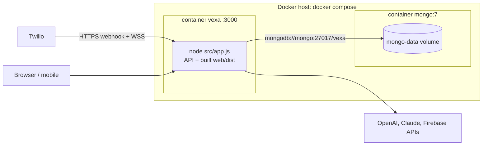
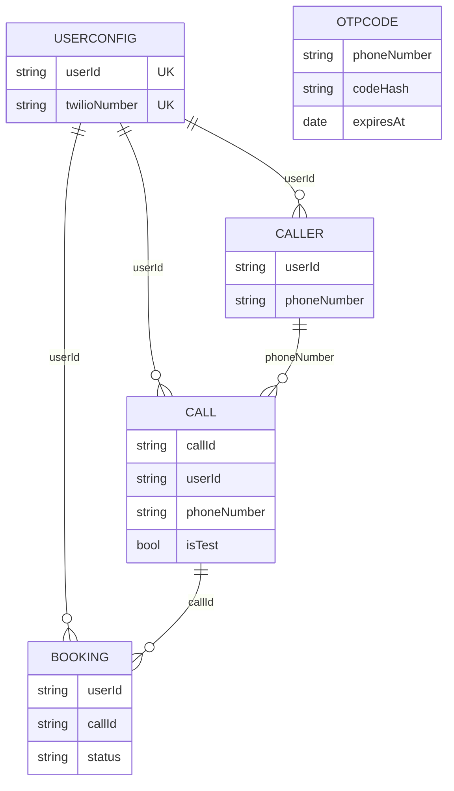

# 📞 Vexa — AI Receptionist for People and Small Businesses

Vexa answers your phone when you can't. It follows **multi-turn call flows** (quote, booking, emergency, delivery and others), understands callers in one sentence, answers their questions mid-call, and only interrupts you when it matters.

It works in two modes:
- **Personal**: screens unknown callers, handles deliveries, shuts down spam, and protects your focus time.
- **Business**: a receptionist that captures leads, takes booking requests, escalates emergencies and texts confirmations.

▶ **Demo video:** [demo/output/vexa-demo.mp4](demo/output/vexa-demo.mp4) (subtitles: [vexa-demo.srt](demo/output/vexa-demo.srt), per-call AI cost: [COSTS.md](demo/output/COSTS.md)). It covers a delivery call with directions and handoff, a loan spam call with negotiation, a trusted-contact call, three business calls (booking, address, stock and price), and a platform tour.

## What makes it different

| Feature | What it does |
|---|---|
| **Flow engine** | Each call type is a playbook of steps: questions, confirmations, if/else branches, actions, transfers. One sentence like "I'm Dana, I need a quote for a water heater tomorrow" fills 4 fields at once, so Vexa skips 3 questions. It answers side questions from your FAQs and then resumes. It switches to the Emergency flow mid-call. A turn cap stops it looping. |
| **Live understanding** | The call screen fills in "Name ✓, Needs ✓, Timing…" while the caller talks. |
| **Copilot** | Steer a live call: "Tell them I'll call back in 10 min", ask for their email, put them through, end politely. |
| **Ask Vexa** | Plain-English commands, typed or spoken: "Tell Dana her parts arrived" (delivered on her next call), "Always put Mom straight through", "Focus for 2 hours", "Block that warranty number", "What did I miss?" |
| **Shields** | Standard, Focus, Spam shield and Silent modes. Each call gets a spam risk score (0–100) before it rings. |
| **Outcomes** | Leads go to your inbox. Booking requests get one-tap approval and a confirmation text. The caller gets an SMS. You get urgent alerts during the call. |
| **8 languages, mid-call switching** | English, Hindi, Telugu, Tamil, Malayalam, Marathi, Gujarati, Spanish. Vexa replies in whatever language the caller is speaking *right now* — Telugu → Hindi → English in one call works. The flow engine stays in English, so playbooks, prices and addresses are written once. |
| **Bilingual transcripts** | Every line is stored as spoken **and** in English; the summary comes in English plus the caller's language. "Read the whole call in…" translates any call into any of the 8 languages on demand (cached). |
| **Call recording** | Phone calls are recorded in stereo (caller left, Vexa right) straight from the media stream — no extra Twilio cost. Tap a transcript line to jump to that moment. Optional "this call may be recorded" notice, auto-delete after 7–365 days, per-call delete. |
| **Phone app** | Installable app (Add to Home Screen) with test calls by voice or text (browser speech). |

```
Caller ─▶ Twilio ─▶ risk score ─▶ Flow engine (English) ◀── NLU: facts + language + English translation
                                     │  says next line ─▶ Realtime voice, in the caller's language ─▶ caller
                                     ├─▶ recorder (stereo WAV) ─▶ signed playback link
                                     ├─▶ live events ─▶ phone app (Copilot, take over)
                                     └─▶ outcomes: lead · booking · SMS · alert · spam tag
```

## Quick start (local, zero config)

```bash
cd backend && npm install && npm run dev      # API on :3000 (embedded MongoDB starts automatically)
cd web && npm install && npm run dev          # Phone app on :5173 (proxies to :3000)
```

Open http://localhost:5173 and sign in with any phone number. In development the login code is filled in and no SMS is sent. Then:

1. Pick **Just me** or **My business** and finish the 3-step setup.
2. You land on a **test call**. Play the caller by typing or using the mic. Try saying everything at once and watch the flow skip questions.
3. On **Home**, tap **Load sample calls**, then explore Activity, a call's detail page, Flows (open one to edit its steps), and the center orb (Ask Vexa).

Without `ANTHROPIC_API_KEY` (or `OPENAI_API_KEY`), understanding uses the deterministic offline engine (English; script-based language detection only). With a key, Claude extracts the facts, detects the language and translates, but the engine still decides every step.

Per-turn latency: set `ANTHROPIC_FAST_MODEL=claude-haiku-4-5` to run understanding and translation on Haiku while post-call analysis stays on the main model. Recordings live in `RECORDINGS_DIR` (default `backend/.data/recordings`).

Multilingual demo against a real model: `node demo/run-multilingual.mjs` (needs the server on :3000), then `node demo/attach-recording.mjs` to attach a synthesized stereo recording to that call.

To run a single server instead: `cd web && npm run build`, then `cd backend && npm start`. The API serves the built dashboard at http://localhost:3000.

## Going live with real calls

1. Fill in `backend/.env` (see `.env.example`): `OPENAI_API_KEY`, `TWILIO_*`, `WEBHOOK_URL`, `MONGODB_URI`, `JWT_SECRET`.
2. Point your Twilio number's voice webhook to `https://YOUR-SERVER/voice/incoming-call`.
3. Forward the business line to the Twilio number. The **Phone setup** page lists the carrier codes.

Deploy: `JWT_SECRET=$(openssl rand -hex 32) docker compose up --build` builds a single image with the API and dashboard, plus MongoDB.

## Project layout

```
backend/   Express API, Twilio webhooks, OpenAI Realtime bridge, Socket.io
  src/voice/        VoiceAgent, PromptGenerator, ConversationAnalyzer
  src/services/     calls, user config, OTP, simulator, Twilio, push
  src/config/       Mongo (embedded in dev), industry templates
  test/             node --test unit tests (npm test)
web/       React + Vite phone app (installable PWA; device frame on desktop)
backend/src/workflows/  flow engine, templates, extractors, NLU, risk, outcomes
mobile/    React Native app (owners on the go)
```

## API overview

| Area | Endpoints |
|---|---|
| Auth | `POST /api/auth/otp/request`, `POST /api/auth/otp/verify`, `POST /api/auth/refresh`, `GET /api/auth/me` |
| Account | `GET/PUT /api/users/config`, `POST /api/users/onboarding`, `GET /api/users/templates`, categories, VIPs, blocked numbers, priority time |
| Calls | `GET /api/calls` (filters: `q`, `category`, `followUp`, `leads`, `includeTest`), `GET /api/calls/stats`, `GET /api/calls/callers`, `GET/DELETE /api/calls/:id`, `PATCH /api/calls/:id/follow-up` |
| Flows | `GET/POST /api/workflows`, `PUT/PATCH/DELETE /api/workflows/:id`, `POST /api/workflows/reset` |
| Assistant | `GET /api/assistant/brief`, `POST /api/assistant/command`, `PUT /api/assistant/shield` |
| Bookings | `GET /api/bookings`, `PATCH /api/bookings/:id` (confirm or decline, texts the caller) |
| Test calls | `POST /api/simulator/start` (`flowId` optional), `/:id/message`, `/:id/whisper`, `/:id/end` |
| Recording & languages | `GET /api/calls/:id/recording-link` (15-min signed URL → `GET /media/recordings/:token`, Range supported), `DELETE /api/calls/:id/recording`, `POST /api/calls/:id/translate` `{ lang }` |
| Voice | Twilio webhooks (signature-checked in production) plus owner actions `POST /voice/takeover`, `/voice/whisper`, `/voice/end-call`, `/voice/outbound-call` (JWT) |

Every `/api/*` route and every owner voice action requires `Authorization: Bearer <token>`. Socket.io clients authenticate with `io(url, { auth: { token } })`.

See [ROADMAP.md](ROADMAP.md) for the launch plan.

## Production Readiness

Review date: 2026-10-26. Reviewer: Claude Code, for Phani Marupaka. Scope: repo at commit `a5b69c5` on `main`. Source: repo files only. Method: `.claude/skills/project-completion-gate/SKILL.md`.

- Backend unit tests ran in this review: `cd backend && npm ci && npm test` gave 36 pass, 0 fail (`backend/test/*.test.js`).
- Not run in this review: web build, mobile tests, Docker build, any live Twilio or OpenAI call.

### Verdict: Not ready

- Rule from the gate: Ready needs no Missing on Guardrails, Security or Human in the loop, and evals must gate the release.
- No dimension is Missing on Guardrails, Security or Human in the loop. All three are Partial, with gaps listed below.
- Evals do not gate a release: no CI exists (`.github/`: Not found in repo).
- Blockers, in order:
  1. No CI or release gate. Tests are never run automatically.
  2. No per-call duration or cost ceiling on live calls.
  3. Live voice path not run end to end (`ROADMAP.md`, "Known gaps").
  4. No dependency or container scanning, no `SECURITY.md`.
  5. No tracing, error alerting or cost alerting.

### Scorecard

| Dimension | Status | Main evidence |
|---|---|---|
| Guardrails | Partial | `backend/src/workflows/engine.js`, `backend/src/voice/PromptGenerator.js`, `backend/src/app.js` |
| Evals | Partial | `backend/test/*.test.js` |
| Observability | Partial | `backend/src/config/logger.js`, `backend/src/lib/usage.js` |
| Security | Partial | `backend/src/middleware/auth.js`, `backend/src/routes/voice.js` |
| Human in the loop | Partial | `backend/src/routes/assistant.js`, `backend/src/routes/voice.js` |
| Architecture diagrams | Present (this section) | Derived from the files cited under each diagram |

### 1. Guardrails: Partial

Present:
- Request size and rate limits: JSON body 1 MB, `/api/` 600 per 15 min, `/voice/outbound-call` 10 per min, simulator 40 per min, Ask Vexa 30 per min, OTP request and verify limiters (`backend/src/app.js`, `backend/src/routes/simulator.js`, `backend/src/routes/assistant.js`, `backend/src/routes/auth.js`).
- Prompt-injection handling for owner-supplied text: `_sanitize` strips markdown characters and replaces known phrases such as "ignore previous instructions" (`backend/src/voice/PromptGenerator.js`). It is a phrase list, not a full defence.
- Flow engine decides each reply; the realtime model only speaks it (`create_response: false`, per `ROADMAP.md`). Flows are validated before use (`backend/src/workflows/validate.js`).
- Turn cap per flow: `maxTurns`, clamped to 2-20, default 10 (`backend/src/workflows/validate.js`, `backend/src/workflows/engine.js` line 675).
- Output schema: Claude calls use `json_schema` structured output (`backend/src/lib/claude.js`).
- Fallback: NLU timeout (`NLU_TIMEOUT_MS`, default 5000 ms) falls back to the offline extractors (`backend/src/workflows/nlu.js`). Claude client uses `maxRetries: 1`.
- Allow-listed actions: `create_lead`, `book_request`, `send_sms`, `notify_owner`, `tag_spam` (`backend/src/workflows/validate.js`, `backend/src/workflows/outcomes.js`).

Gaps and what can go wrong:
- Per-call duration cap and per-call cost ceiling: Not found in repo (`TODO.md` section 9 lists them unchecked). A stuck or abusive call can run and bill until the caller or Twilio ends it.
- Caller speech is passed to the model as the user message in `backend/src/workflows/nlu.js`. Injection handling there rests on structured output only; `_sanitize` is not applied to it. A caller could try to steer extraction. Structured output limits the damage; it does not remove it.
- OpenAI fallback path: schema is described in the prompt only (`backend/src/lib/llm.js`). Output can fail to match the schema.
- PII filtering on output or on stored transcripts: Not found in repo. Transcripts hold whatever callers say.
- Voice-to-flow transfer is triggered by matching the phrase "transferring you now" in the AI's own words (`backend/src/voice/VoiceAgent.js` line 674). A paraphrase would not trigger a transfer.

Action: add a hard call-duration limit in `VoiceAgent` and a per-call cost ceiling using the ledger in `backend/src/lib/usage.js`.

### 2. Evals: Partial

Present:
- 36 backend tests with expected outcomes: engine conversations, extractors, Ask Vexa grammar, hours, multilingual (`backend/test/core.test.js`, `backend/test/workflows.test.js`, `backend/test/multilingual.test.js`). They passed in this review.
- Mobile tests: `mobile/__tests__/` (3 files). Not run in this review.
- Per-call cost and latency are recorded (`backend/src/lib/usage.js`), and sample costs are in `demo/output/COSTS.md`.

Gaps and what can go wrong:
- CI: Not found in repo (no `.github/`, no other CI config). A broken change can merge and ship unnoticed.
- Test set for model-backed behaviour (Claude extraction, translation, post-call analysis) with pass thresholds: Not found in repo. Tests cover the offline engine; model quality can regress silently.
- Judge calibration: Not applicable, no LLM grader found in repo.
- Web tests: Not found in repo (`web/package.json` has no test script).
- Tests run against the live voice path: Not found in repo. `ROADMAP.md` says the voice path has not been run end to end.

Action: add a GitHub Actions workflow that runs `npm test` in `backend/` and `web` build on every PR, and make it a required check.

### 3. Observability: Partial

Present:
- Winston logger, JSON format in production, file transports with rotation (`backend/src/config/logger.js`).
- Per-call AI usage ledger: tokens, cost, latency by purpose (`backend/src/lib/usage.js`).
- `/health` endpoint returns 503 when MongoDB is down (`backend/src/app.js`).
- Action results are stored on each call with a status (`backend/src/workflows/outcomes.js`).

Gaps and what can go wrong:
- Much of the code uses `console.log` (112 occurrences in `backend/src`) instead of the logger. Those lines are not JSON and not in the log files.
- Request or run IDs in logs: Not found in repo. Tracing one call across services means searching by hand.
- Traces and metrics export (OpenTelemetry, Prometheus, Sentry): Not found in repo (`ROADMAP.md` Phase 1 lists Sentry as open).
- Alerts on failure or cost spikes: Not found in repo. A failing voice path or a cost spike is seen only if someone reads the logs.
- Audit trail of who changed settings or flows: Not found in repo.

Action: replace `console.*` with the logger, add a call ID to each log line, and add Sentry as listed in `ROADMAP.md`.

### 4. Security: Partial

Present:
- Secrets via environment variables; `.env` is git-ignored; `backend/.env.example` has empty values. Production refuses to start without a strong `JWT_SECRET` (`backend/src/middleware/auth.js`).
- JWT on `/api/*` and on owner voice actions; refresh tokens rejected as access tokens; calls checked against the owner (`backend/src/middleware/auth.js`, `backend/src/routes/voice.js` `ownedCall`).
- Twilio signature check on webhooks, on by default in production (`backend/src/routes/voice.js`).
- Socket.io requires a JWT; the server picks the room (`backend/src/app.js`).
- OTP login: hashed codes, 10 min TTL, 5 attempts, rate limits (`backend/src/services/otpService.js`, `backend/src/routes/auth.js`).
- `helmet`, CORS allow-list in production, signed 15-minute recording links (`backend/src/app.js`, `backend/src/routes/media.js`).
- Recording retention 7-365 days, per-call recording delete, per-call delete (`backend/src/routes/media.js`, `backend/src/routes/calls.js`).
- Demo data and WAV upload are disabled in production unless `ENABLE_DEMO_DATA=true`.

Gaps and what can go wrong:
- `SECURITY.md`: Not found in repo. There is no stated way to report a vulnerability.
- Dependency or container scanning (Dependabot, `npm audit` in CI, image scan): Not found in repo. Known-vulnerable packages can ship.
- `backend/src/routes/webhooks.js` has unauthenticated POST routes (`/call-started`, `/call-ended`, `/transcript-update`) that trigger push notifications from request-body `userId`. The router is not mounted in `backend/src/app.js` today. If someone mounts it, anyone can send pushes to any user. Remove the file or add auth.
- `/voice/media-stream` WebSocket has no signature check in `backend/src/app.js`; it relies on the `callSid` matching an active call (`backend/src/voice/VoiceAgent.js` line 369). Not tested here.
- JWT lifetime is 7 days with no server-side revocation list (`backend/src/middleware/auth.js`). A leaked token works until it expires.
- Recording link secret falls back to the dev secret when `JWT_SECRET` is unset (`backend/src/routes/media.js`). Production startup blocks this through `auth.js`, so the risk is limited to non-production.
- CORS and Socket.io allow `*` outside production (`backend/src/app.js`).
- CSP is disabled in `helmet` (`contentSecurityPolicy: false`).
- Transcript retention: only recordings expire. Transcripts stay until the owner deletes a call. Account deletion endpoint: Not found in repo.
- `mobile/android/app/debug.keystore` is committed and used for the build config (`mobile/android/app/build.gradle`). It is the default debug key; the file comment says a release keystore is still to be created. Do not ship a release with it.
- Mobile token storage: not verified in this review (`mobile/src/services/api.ts` holds tokens in memory; persistence location not checked).
- Docker: container runs as root, no `HEALTHCHECK` (`Dockerfile`). `docker-compose.yml` publishes port 3000 and MongoDB has no authentication configured in the file.

Action: add `SECURITY.md`, enable Dependabot and `npm audit` in CI, delete or protect `backend/src/routes/webhooks.js`.

### 5. Human in the loop: Partial

Present:
- Booking requests need owner approval; the AI never confirms a slot (`backend/src/models/mongodb/Booking.js`, `backend/src/routes/assistant.js` `PATCH /api/bookings/:id`). The caller is texted after approval.
- Owner can take over a live call (`POST /voice/takeover`), steer it (`/voice/whisper`), or end it (`/voice/end-call`) (`backend/src/routes/voice.js`).
- Escalation: emergency flow, "wants human" flag, AI-triggered transfer to the owner or a front-desk number (`backend/src/workflows/nlu.js`, `backend/src/voice/VoiceAgent.js`).
- Shield modes, including Silent and Focus, and a spam score of 80 or more in Aggressive mode rejects the call (`backend/src/routes/voice.js`).
- Owner can turn flows off per account (`flowsDisabled`, `backend/src/routes/voice.js`).
- Follow-up inbox with status for leads (`backend/src/routes/calls.js`).

Gaps and what can go wrong:
- `send_sms` to the caller runs without owner approval (`backend/src/workflows/outcomes.js`). A wrong or unwanted text goes to a real number. Owner-set templates limit the content.
- Rejected high-risk calls (score 80+) are not placed in a review queue (`backend/src/routes/voice.js`). A real caller scored high is lost without a trace beyond a log line. Not verified whether the rejection is stored in call history.
- Reviewer decision record: booking status is stored; who changed it and when beyond `updatedAt` is Not found in repo.
- Global kill switch for all voice handling (not per account): Not found in repo.
- Low-confidence escalation: confidence is stored for category matching (`backend/src/models/mongodb/Call.js`); a rule that escalates on low confidence is Not found in repo.

Action: add an owner setting that requires approval for outbound SMS, and store rejected calls.

### 6. Architecture diagrams

All diagrams are derived from the files named under each one. Parts the code does not have are marked, not drawn.

Not drawn, code does not support them:
- Swimlane and waterfall diagrams: not in the requested set for this review.
- Multi-instance deployment: active calls are held in process memory (`backend/src/voice/VoiceAgent.js` `activeCalls`; `ROADMAP.md` "Known gaps"). `backend/src/config/redis.js` exists but no file imports it. Only a single instance is drawn.

#### C4 L1: System context

Source: `README.md`, `backend/src/routes/voice.js`, `backend/src/lib/llm.js`, `backend/src/services/pushNotificationService.js`.



#### C4 L2: Containers

Source: `docker-compose.yml`, `Dockerfile`, `backend/src/app.js`, `web/`, `mobile/`.


Note: in development MongoDB is embedded (`backend/src/config/mongodb.js`) and the web app runs on Vite port 5173.

#### C4 L3: Components of the API container

Source: `backend/src/app.js`, `backend/src/routes/`, `backend/src/voice/`, `backend/src/workflows/`, `backend/src/services/`, `backend/src/lib/`.



#### Data flow

Source: `backend/src/routes/voice.js`, `backend/src/workflows/callSession.js`, `backend/src/workflows/outcomes.js`.


#### Sequence: incoming call

Source: `backend/src/routes/voice.js` (`/incoming-call`), `backend/src/voice/VoiceAgent.js`, `backend/src/workflows/callSession.js`.



#### State machine: flow session

Source: `backend/src/workflows/engine.js`, `backend/src/workflows/validate.js` (step types: collect, confirm, say, branch, action, transfer, end, goto, lookup). The states below are the step types and end conditions; exact transitions inside `engine.js` are not all traced here.



#### State machine: booking

Source: `backend/src/models/mongodb/Booking.js` (status enum), `backend/src/routes/assistant.js` (PATCH accepts any of the four statuses from any state; no transition rules found).



Only `requested`, `confirmed`, `declined`, `cancelled` are in the code. The PATCH route does not restrict transitions, so the arrows above show the intended use, not an enforced rule.

#### Deployment

Source: `Dockerfile`, `docker-compose.yml`.



Not shown because not in the repo: reverse proxy or TLS termination, cloud hosting target, volume for recordings (the compose file mounts only `mongo-data`, so recordings in the container are lost on rebuild).

#### Entity relationship

Source: `backend/src/models/mongodb/*.js`. Links are by `userId` and phone number strings, not Mongo references.



### 7. README

Present: what it is, quick start, API overview (this file). Test command is in `backend/package.json`; the README does not state `npm test` in the quick start (it appears under "Project layout"). Not found in repo: CI badge, `.github/`.

### Open items register

| # | Item | Owner | Date |
|---|---|---|---|
| 1 | Add CI that runs backend tests and web build on every PR; make it a required check | Phani Marupaka | 2026-10-26 |
| 2 | Add call-duration limit and per-call cost ceiling | Phani Marupaka | 2026-10-26 |
| 3 | Run the live voice path end to end and record latency (`ROADMAP.md` Known gaps) | Phani Marupaka | 2026-10-26 |
| 4 | Add `SECURITY.md`, Dependabot and `npm audit` in CI | Phani Marupaka | 2026-10-26 |
| 5 | Delete or protect `backend/src/routes/webhooks.js` | Phani Marupaka | 2026-10-26 |
| 6 | Add call IDs to logs, replace `console.*` with the logger, add error and cost alerts | Phani Marupaka | 2026-10-26 |
| 7 | Add an eval set for Claude-backed extraction and analysis with a pass threshold | Phani Marupaka | 2026-10-26 |
| 8 | Add owner approval option for outbound SMS; store rejected high-risk calls | Phani Marupaka | 2026-10-26 |
| 9 | Add account deletion and transcript retention | Phani Marupaka | 2026-10-26 |
| 10 | Create a release Android keystore; stop using `debug.keystore` for release | Phani Marupaka | 2026-10-26 |
| 11 | Check `/voice/media-stream` WebSocket handling when no matching call exists | Phani Marupaka | 2026-10-26 |
| 12 | Decide on mobile app: keep React Native or move to the PWA (`ROADMAP.md` recommends Capacitor) | Phani Marupaka | 2026-10-26 |

Owner is Phani Marupaka for all items; the repo names no other owner. Dates are the review date; the repo gives no due dates, so each owner should set a real date.

## License

MIT
